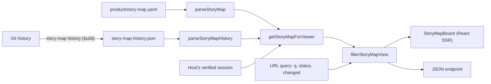

# Embedded Story Map: engineering overview

Prepared 20 November 2026 for version 0.3.0, and updated for the unreleased 0.4.0 work on validator warnings and blocked and cut statuses. Start here before changing the library. The [README](../README.md) and [the story map guide](story-map.md) describe how host products use it. This document explains how it works inside and which behaviour to preserve.

## What this library does

Embedded Story Map lets a product show its own user story map at `/story-map`, behind the product's existing sign-in. Activities (the steps of the user journey) run left to right. Releases (delivery slices) run top to bottom. Each story sits in one activity and one release and has a status of `planned`, `in-progress`, `shipped`, `blocked` or `cut`. The first three are the active statuses. Blocked and cut stories are hidden by default and never shown to customers.

The map is a YAML file, `product/story-map.yaml`, committed in the host product's repository. It is edited through pull requests, like code, and ships with each deployment. Nothing is stored in a database, and the board is read-only.

The package has four parts:

- **A core library** that parses and validates the YAML, projects it for a viewer, and filters the projection.
- **A React board** that renders a projection as server-side HTML, with a detail panel for each story. The panels work without client-side JavaScript.
- **A CLI**, `story-map`, with `init`, `validate`, `diff` and `history` commands for setup, CI, PR summaries and Git-derived status history.
- **Agent and editor support**: a guide and `AGENTS.md` section that `init` copies into the host, plus a JSON Schema for editor autocomplete.

Two audiences see the map. Internal viewers (by default the `engineer` and `super-admin` roles) see everything. Other signed-in users see a reduced customer-facing view, but only when the map has `visibility: all-users` and the story has approved customer copy. Guests see nothing.

## Runtime and architecture

| Layer | Implementation |
| --- | --- |
| Language | TypeScript 5.9, compiled by `tsc` to ES2022 ES modules in `dist/`. No bundler. |
| Runtime | Node.js 20 or newer. CI tests Node 20 and 26. |
| Dependencies | `yaml` (parsing with source positions) and `zod` 4 (validation and JSON Schema generation). |
| UI | React 18 or 19, an optional peer dependency. The board is a plain function component with no state or effects. |
| Styling | One namespaced stylesheet, `styles.css`, using `.esm-*` classes and `--esm-*` custom properties. |
| Git | The `diff` and `history` commands shell out to `git` with `execFile`, never through a shell. |
| Distribution | npm package `embedded-story-map`, published from version tags with npm trusted publishing. |

The library never handles authentication, HTTP or storage itself. The host reads the YAML, resolves the viewer from its own verified session, and passes both in. Data flows one way:



`getStoryMapForViewer` is the security boundary. Everything after it only sees what the viewer is allowed to see.

### Package entry points

`package.json` `exports` defines the public surface. Anything not listed there is internal, even if it is in `dist/`.

| Import | File | Contents |
| --- | --- | --- |
| `embedded-story-map` | `dist/index.js` | Parsing, validation errors, projection, filters, history parsing, diff |
| `embedded-story-map/react` | `dist/react.js` | `StoryMapBoard` |
| `embedded-story-map/styles.css` | `styles.css` | Board stylesheet |
| `embedded-story-map/schema.json` | `story-map.schema.json` | JSON Schema for editors |
| `story-map` (bin) | `dist/cli.js` | CLI |

`buildStoryMapHistory` (`src/history-git.ts`), `loadStoryMap`, `checkSources`, `checkPlanReferences` and `initStoryMap` are not exported from the root entry point. Hosts reach them through the CLI. The demo imports `dist/history-git.js` directly, which is fine inside this repository but not a supported API.

The tests and the demo import the package by its own name (`import … from "embedded-story-map"`). Node resolves this through the package's `exports`, so they exercise the built `dist/` output exactly as a host would. Run `npm run build` before running them; `npm test` and `npm run demo` do this for you.

## Code map

| Path | Responsibility |
| --- | --- |
| `src/status.ts` | The five statuses, the active subset, and their display labels. The single list every other module reads. |
| `src/schema.ts` | Zod schema for the YAML, cross-reference checks, warnings (`storyMapWarnings`), `parseStoryMap`, `loadStoryMap`, `StoryMapValidationError` and source-line lookup |
| `src/view.ts` | `getStoryMapForViewer`: the internal and customer projections, role check, and attaching history to stories |
| `src/filter.ts` | `readStoryMapFilters` (URL parameters) and `filterStoryMapView` (search, status and “changed in” filters) |
| `src/history.ts` | History file types and `parseStoryMapHistory` |
| `src/history-git.ts` | `buildStoryMapHistory`: walks the map's Git history and records additions and status changes |
| `src/diff.ts` | `diffStoryMaps` and `formatStoryMapDiff`: compares two map versions and renders the PR summary |
| `src/references.ts` | `--check-sources` (files and GitHub heading anchors) and `--plans` (story IDs in Markdown) |
| `src/init.ts` | `story-map init`: writes the starter map, guide, `AGENTS.md` section and CI workflow without overwriting |
| `src/cli.ts` | Argument parsing, output formats and exit codes for the four commands |
| `src/react.tsx` | `StoryMapBoard`: grid, cards, popover panels, filter toolbar, history list and date formatting |
| `src/index.ts` | Root entry point re-exports |
| `styles.css` | Board styles, light, dark and `auto` themes, and the narrow-screen layout |
| `templates/` | Files `init` copies into a host: starter `story-map.yaml`, `AGENTS.md` section and `story-map-ci.yml` |
| `docs/story-map.md` | The user guide. **It is also shipped in the package and copied into hosts by `init`.** |
| `docs/plans/` | Delivery plans. `0.4.0-enhancements.md` is the proposed next release. |
| `docs/releasing.md` | How to publish a version |
| `product/story-map.yaml` | The builder estimates demo map. It is test data and the demo's content, not a map of this library. |
| `example/host.mjs` | Reference host integration: one function that returns a web `Response` for the page or the JSON endpoint |
| `example/demo.mjs` | Local demo server on `127.0.0.1:4173` with a role switcher |
| `scripts/build-schema.mjs` | Generates `story-map.schema.json` from the compiled Zod schema |
| `scripts/smoke-package.sh` | Packs the tarball, installs it into an empty project and checks the imports, CLI and board |
| `test/story-map.test.mjs` | All tests, using `node:test` |
| `.github/workflows/` | `ci.yml` for PRs and `main`, `release.yml` for version tags |

## The map file

### Format

`src/schema.ts` is the source of truth for the format. The top level has `version: 1`, `id`, `title`, optional `summary`, `visibility` (`internal` by default, or `all-users`), optional `customer` copy, and the `activities`, `releases` and `stories` lists.

- The order of `activities` is the journey order. The order of `releases` is the delivery order. The order of `stories` is the order within each cell.
- IDs match `^[A-Za-z0-9][A-Za-z0-9_-]{0,63}$`. Story IDs such as `BUILDER-102` are stable: renaming or moving a story keeps its ID, and history, diffs and delivery plans all key on it.
- A story's `status` defaults to `planned`. `statusReason` (up to 500 characters) records why a story is blocked or cut.
- `sources` is a list of up to 20 strings. A string is either a URL, a repository-relative path (optionally with a `#heading`), or free text such as “Agreed in planning”.
- Every object is `.strict()`, so an unknown field is an error rather than being silently dropped. This catches typos such as `staus`.
- Size limits (titles 120 characters, summaries 500, notes 4,000, 50 activities or releases, 1,000 stories) keep a malformed or hostile file from producing an unusable page.

Cross-reference rules, checked in `crossReferenceIssues`:

- IDs are unique within each list.
- Each story's `activity` and `release` exist.
- An `all-users` map needs map-level `customer` copy.
- A story with `customer` copy needs customer copy on its activity and its release, so a customer never sees an internal label.

### Parsing and error reporting

`parseStoryMap(text)` returns a typed `StoryMapDocument` or throws `StoryMapValidationError`, whose `issues` each have a `severity`, `path`, `message`, `line`, `column` and the `itemId` of the containing activity, release or story.

Issues are errors or warnings. Errors make the map invalid and are thrown. Warnings are advice about a valid map, such as a blocked or cut story with no `statusReason`. `storyMapWarnings(map)` computes them from the parsed document, and `loadStoryMap` returns them, located in the source, as `warnings`. `parseStoryMap` drops them. Never make a warning depend on something an error would catch: warnings only run once the map is valid.

How `loadStoryMap` gets there:

1. Parse with `yaml`'s `parseDocument` and a `LineCounter`, with `uniqueKeys: true` so duplicate keys are errors. YAML syntax errors are reported immediately.
2. Convert to plain data with `maxAliasCount: 20`, which stops alias-expansion (“billion laughs”) files.
3. Validate with Zod, with a custom error map for clearer “Missing required field.” and “Use one of …” messages.
4. If Zod fails, run `crossReferenceIssues` again on the raw data. Zod skips `superRefine` once any field fails, so without this step a file with one typo would hide its broken references until the next run. Issues are deduplicated against Zod's.
5. Map each issue path back to a YAML node to get its line and column. `unrecognized_keys` issues are split into one issue per key, located at the key itself.
6. Sort issues by line.

`loadStoryMap` also returns `warnings` and `locate(path)` so later checks, such as `--check-sources`, can report positions in the same file.

### JSON Schema

`story-map.schema.json` is generated, not hand-written. `npm run build` runs `tsc` and then `scripts/build-schema.mjs`, which calls `z.toJSONSchema(storyMapSchema, { io: "input" })`. The `input` mode means fields with defaults, such as `status`, are optional for editors. Field descriptions come from the `.describe()` calls in `src/schema.ts`, so edit them there.

The generated file is committed because hosts reference it from `node_modules` and the starter map's `yaml-language-server` comment points at it. CI fails if the committed file differs from a fresh build. After any schema change, run `npm run build` and commit `story-map.schema.json`.

The JSON Schema cannot express the cross-reference rules. Editors catch shape errors; only the validator catches duplicate IDs and unknown references.

## Audience projection

`getStoryMapForViewer(map, viewer, { canViewInternal, history })` in `src/view.ts` decides what a viewer may see and builds a new object containing only that. It returns `null` for no access.

| Viewer | Result |
| --- | --- |
| `null` (guest) | `null`. The host should answer 401. |
| `canViewInternal(viewer) === true` | Internal view: all activities, releases and stories, with IDs, notes, sources, `updatedBy` and history |
| Anyone else, `visibility: all-users` | Customer view |
| Anyone else, `visibility: internal` | `null`. The host should answer 403. |

The default `canViewInternal` checks for the `engineer` or `super-admin` role (`defaultInternalRoles`). Hosts can pass their own rule. Only a strict `true` grants access, so a rule that returns a truthy string or a promise does not accidentally open the internal map.

The customer view is built from scratch, not by deleting fields from the internal one:

- Only stories with `customer` copy and an active status are included, using the customer title and summary. Blocked and cut stories are dropped before activities and releases are chosen, so a release that only contains them disappears too.
- Only activities and releases that contain a published story and have customer copy are included.
- Real IDs are replaced with sequential ones (`story-1`, `activity-1`, `release-1`), so internal IDs and the number of hidden stories do not leak.
- Notes, sources, `statusReason`, `updatedBy` and history are never copied.
- The status is shown as it is. Reviewers must check that a customer-facing story's status is right for customers.

Both views have the same `StoryMapView` shape apart from `audience`, so the board and JSON endpoint treat them alike.

When history is supplied, the internal view attaches each story's events newest first as `history`, and the newest event's time as `lastChangedAt`. It also records `history.generatedAt` and `history.complete` on the view so the board knows a history exists.

## Search and filters

`readStoryMapFilters(url.searchParams)` reads three parameters and ignores anything unknown:

- `q`: trimmed and cut to 100 characters
- `status`: one of the five statuses, or `all`
- `changed`: `1d`, `7d`, `14d` or `30d`

`filterStoryMapView(view, filters, { now })` returns a copy of the view with fewer stories and a `filter` object recording the active filters and the unfiltered total. The board shows its toolbar only when `filter` is present, so hosts that do not call it get a board without search.

With no `status`, the filter keeps only active stories and records in `filter.hidden` how many blocked and cut stories matched the other filters but were hidden. The board shows that count with a link to `status=all`. A host that never calls `filterStoryMapView` renders every story, including blocked and cut ones. Customer views contain no blocked or cut stories, so for them the default changes nothing, and their status select offers only the active statuses.

Always filter after projecting. The search runs over the projected view, so a customer's search matches only approved titles and summaries, while an internal search also matches IDs and notes. Filtering the raw document first would let a search reveal hidden content through which results come back.

The “changed in” filter only applies to internal views that have history. It keeps stories whose `lastChangedAt` falls in the window, measured from `now`. Moving a story between activities or releases is not a change for this purpose; only additions and status changes are.

## The React board

`StoryMapBoard` in `src/react.tsx` is designed for server-side rendering with `renderToStaticMarkup`. It has no state, effects or event handlers, so it also works when hydrated, but nothing depends on client JavaScript.

### Layout

- The grid is a set of `div`s with ARIA `table`, `row`, `columnheader`, `rowheader` and `cell` roles. `--esm-columns` on the grid sets the number of activity columns for CSS grid.
- Stories are grouped by `release:activity` key. Stories whose activity or release is missing from the view are skipped (`placed`), which also guards against a host passing a hand-built view.
- While filtering, releases with no matching stories are hidden. Without filters, every release shows, even when empty, so engineers can see the full plan. The default Active status filter does not count as filtering for this, and neither does `status=all`.
- Release lanes cycle through three colour schemes using `data-lane` (index modulo 3).
- The eyebrow reads “User story map” for internal viewers and “Roadmap” for customers.

### Detail panels without JavaScript

Each card is a `<button>` with a `popovertarget` pointing at its panel. Each panel is a `<div popover="auto" role="dialog">` rendered after the grid. The browser's HTML popover API opens and closes it, handles Escape and light dismiss, and shows a `::backdrop`. The close button uses `popovertargetaction="hide"` and `autofocus`.

React 19 knows these attributes by their camelCase names, while React 18 only passes them through in lower case. `popoverTarget()` picks the right spelling from React's `version`. The smoke test renders the board with both React versions and checks that every card's target matches a panel ID, so keep that test passing when touching this code.

Panel IDs come from `useId()`, so two boards on one page do not collide.

### Engineering links

`resolveSources` turns each source into a link or plain text:

- A source containing whitespace is free text.
- Otherwise it is resolved with `new URL(source, sourceBaseUrl)`. Only `http:` and `https:` results become links, so a `javascript:` source cannot produce a clickable link.
- The first link whose path ends in `.md` and has a `#fragment` becomes the **Engineering overview** button. The rest are listed as sources.
- Without `sourceBaseUrl`, repository-relative paths cannot be resolved and show as plain text. Absolute URLs still work.

Engineering links open in a new tab with `rel="noopener noreferrer"`, an icon and screen-reader text.

### Filter toolbar

The toolbar is a `GET` form with no `action`, so it submits to the current page. `preservedParams` become hidden inputs, so a host can keep its own query parameters (the demo keeps `as`). “Clear filters” links to just the preserved parameters. The **Changed** select appears only for internal views with history.

### Dates

`locale` (default `en-GB`), `timeZone` and `now` control date output. Cards show relative times (“5 hours ago”, “yesterday”), switching to a date after 30 days. Without `timeZone`, dates use the server's zone, which may not match the team's. Tests pass a fixed `now` so output is deterministic.

### Styling

All classes start with `esm-` and all colours are `--esm-*` custom properties on `.esm-board`, so hosts can restyle without overriding selectors. `data-theme` selects `light`, `dark` or `auto`.

The dark palette is written out twice in `styles.css`: under `[data-theme="dark"]` and under `[data-theme="auto"]` inside `@media (prefers-color-scheme: dark)`. The panel backdrop is set the same way. Change both copies together.

Below 650px wide, each release lane becomes a stacked section, the activity header row is visually hidden (it stays available to screen readers), each cell shows its activity name, and empty cells are hidden.

Class names and markup are part of the public contract. Hosts may have CSS that targets them, so changing them is a breaking change. 0.3.0 did this and documented an upgrade step.

## Status history

Status history shows when each story was added or changed status, who made the change and who merged it. It is derived from Git rather than recorded in the YAML, so editors never maintain it by hand.

### Building it

`story-map history --out build/story-map-history.json` runs `buildStoryMapHistory` (`src/history-git.ts`) at the host's build time:

1. Refuse a shallow clone unless `--allow-shallow` is passed. In a shallow clone, the oldest version found is used only as a baseline, so stories that already existed are not reported as added on that date. The output then has `complete: false`.
2. List commits that touched the map with `git log --first-parent --reverse` on the chosen ref, usually `main`. First-parent means each change is dated when it reached that branch, not when it was written on a feature branch.
3. Read each version with `git show <sha>:<path>` and parse it. Versions that are missing or do not validate are skipped, and the next valid version is compared with the last valid one.
4. Compare each version's stories with the previous one by ID. A new ID produces an `added` event. A changed `status` produces a `status` event with `from` and `to`. When the new status is blocked or cut and the story has a `statusReason`, the event records it as `reason`. Moves, renames and other edits produce nothing, and removing a story produces no event.
5. Store `at` as the commit's committer date, normalised with `toISOString()`. Git versions print UTC as either `+00:00` or `Z`, and a canonical form keeps the file stable and comparable.

Who is credited:

- **`by`**: the story's `updatedBy` if this change set or changed it. Otherwise the commit author. For a merge commit, it is the author of the latest non-merge commit on the merged branch that touched the map, found with one extra `git log` per merge, and cached for that commit.
- **`mergedBy`**: for a merge commit, its author (the person who merged). For a single-parent commit, the committer, unless the committer is `GitHub`. GitHub records itself as the committer of squash and rebase merges made on the website, so those entries have no `mergedBy`.

### Using it

The host reads the JSON with `parseStoryMapHistory`, which validates it with Zod, and passes it to `getStoryMapForViewer` as `history`. Only internal views receive it. The file contains people's names, so the guide tells hosts to keep it out of static asset directories.

A host without a history file loses nothing else: no dates on cards, no history in panels and no **Changed** filter.

## CLI

`src/cli.ts` parses arguments by hand to avoid a dependency. Options accept both `--name value` and `--name=value`. An unknown option or a missing value prints the usage and exits with code 2.

| Command | What it does | Exit codes |
| --- | --- | --- |
| `validate [--format text\|github] [--strict] [--check-sources] [--plans <dir>]… [--root <dir>] <map>…` | Parses each map, then runs the optional reference checks | 0 valid (warnings allowed), 1 errors, or warnings with `--strict` |
| `diff [--format markdown\|json] [--map <path>] <base-ref>` | Compares the working copy of the map with its version at a Git ref | 0, 1 invalid map, 2 Git or usage error |
| `history [--map] [--ref] [--out] [--allow-shallow]` | Writes the history JSON | 0, 1, 2 Git error or shallow clone |
| `init [--no-ci] [--dir <path>]` | Sets up a host repository | 0 |

### validate

Text output goes to stderr as `file:line:column: path (ITEM-ID): message`, with `warning: ` before the path for warnings. `--format github` prints `::error` or `::warning file=…,line=…,col=…::` workflow commands to stdout, escaping `%`, newlines, `:` and `,` as GitHub requires, so problems appear on the PR diff.

`--check-sources` (`checkSources` in `src/references.ts`) looks at each source that looks like a path: no whitespace, no URL scheme and no leading `//`. It reports files that do not exist and paths that resolve outside `--root`. For Markdown files with a fragment, it checks the fragment against `markdownAnchors`, which reimplements GitHub's anchor rules: strip inline Markdown and HTML, lower-case, drop punctuation, turn spaces into hyphens, add `-1`, `-2` suffixes for duplicate headings, skip fenced code blocks, and accept Setext headings and `<a id>`/`<a name>` anchors. If GitHub's rendering and this function disagree, the validator either accepts a broken link or rejects a working one, so test any change against real GitHub output.

`--plans <dir>` (`checkPlanReferences`) scans Markdown under the folder for story IDs. It only checks IDs whose prefix the map already uses (`BUILDER-` in `BUILDER-102`), so ordinary text such as `UTF-8` is not flagged. This repository runs it over `docs/`, so any `BUILDER-` or `FINANCE-` ID mentioned there must exist in the demo map.

### diff

`diff` reads the base version with `git show <ref>:<path>`. If the file did not exist at that ref, the map is reported as new. If the base version is invalid, the command fails rather than guessing.

`diffStoryMaps(before, after)` matches stories, activities and releases by ID, so a rename is a rename rather than a removal and an addition. It reports:

- **Customer-facing changes** first: stories that become visible or stop being visible to signed-in customers, and visible stories whose customer title, summary, status or customer-facing activity or release changes. A story counts as visible only when the map is `all-users`, has map customer copy and the story has customer copy.
- Visibility switches, as a GitHub `[!IMPORTANT]` or `[!NOTE]` alert.
- A **Blocked and cut** section (`blockedOrCut`): stories that became blocked or cut, with their reasons, and stories that returned to an active status. A blocked or cut story does not count as customer-visible, so a published story that becomes blocked or cut also appears under “No longer visible”.
- Added, moved, renamed, re-statused, edited and removed stories, in one table.
- Added, renamed, removed and reordered activities and releases, and changes to their customer labels.

`formatStoryMapDiff` escapes all text taken from the map (HTML, Markdown punctuation, `|` and newlines), because the summary is written into PR job summaries and table cells. A story title must not be able to inject Markdown or break the table.

### init

`initStoryMap` writes files with the `wx` flag, so it can never overwrite an existing file. Re-running it is safe:

- `product/story-map.yaml` from `templates/story-map.yaml`, with `__ID__` and `__TITLE__` filled from the host's `package.json` name (without its scope) or folder name.
- `docs/story-map.md`, copied from this package's `docs/story-map.md`. If the host already has a different copy, it is left alone and the output says to compare it.
- `AGENTS.md`: created, or the section from `templates/AGENTS.md` appended. The `<!-- embedded-story-map:start -->` marker prevents appending twice.
- `.github/workflows/story-map.yml`, only when the host has a `package-lock.json`, because the workflow uses `npm ci`. Skipped with `--no-ci`.

Templates and the guide are found relative to the compiled `dist/init.js` (`new URL("../", import.meta.url)`). They must stay in the package `files` list.

## Security boundaries to preserve

- **Project, then filter, then render.** Never pass the parsed document to the board or a JSON response, and never filter before projecting.
- **Build the customer view from an allow-list.** When adding a field to stories, decide explicitly whether customers see it. The default must be no. The tests check that customer HTML and JSON contain none of the internal content.
- **`canViewInternal` must return `true`.** Keep the strict comparison.
- **Keep internal IDs out of the customer view.** Customer IDs are renumbered on purpose.
- **Blocked and cut stay internal.** The customer projection drops them, and tests check that customer HTML and JSON never mention them or their reasons.
- **History contains names.** Keep it internal-only and out of static assets.
- **Responses are private.** The example host sends `Cache-Control: private, no-store` and `X-Content-Type-Options: nosniff`. Hosts are told to do the same, because the page differs per viewer.
- **Only `http` and `https` sources become links.** React escapes all text, and the board never uses `dangerouslySetInnerHTML`. A test checks that story text renders as text.
- **Git arguments are not shell input.** `git` runs through `execFile` with an argument array, and refs starting with `-` are rejected so they cannot be read as options.
- **Source checks stay inside the repository.** Paths that resolve outside `--root` are reported, not read.
- **Bounded input.** Keep the schema's length and count limits and the YAML alias limit.
- **The demo is not an auth model.** `example/demo.mjs` picks a role from `?as=` and listens only on `127.0.0.1`. Real hosts must take roles from their verified session.

## Local setup

Use Node.js 20 or newer.

```sh
npm ci
npm test
npm run validate
npm run demo
```

`npm ci` runs `prepare`, which builds `dist/` and regenerates the schema. `npm test` rebuilds and runs `node --test`. `npm run validate` validates the demo map with `--check-sources --plans docs`.

`npm run demo` starts [the demo](http://127.0.0.1:4173/story-map). Set `STORY_MAP_DEMO_PORT` to use another port. The demo:

- reads `product/story-map.yaml` on every request, so YAML edits show up on refresh,
- builds history from this repository's Git history at startup, allowing a shallow clone, and logs a warning if Git is unavailable,
- offers Regular user, Product manager, Engineer, Super admin and Guest views. It passes a custom `canViewInternal` that also admits `product-manager`, to show that option in use,
- links sources to this repository on GitHub with `sourceBaseUrl`.

`dist/` is ignored by Git. If an import fails or behaviour does not match the source, rebuild.

## Tests and CI

All tests are in `test/story-map.test.mjs` and use `node:test` with `node:assert/strict`. They cover:

- parsing defaults, duplicate keys and IDs, dangling references, customer-label rules, and error lines and item IDs,
- audience rules on the HTML page and JSON endpoint through `example/host.mjs`, including that customer output contains no internal content,
- card faces, popover panels, engineering links, sources after a JSON round trip, themes and escaping,
- filters, including that searches only see the projected view,
- the CLI's text and GitHub output, `diff` against a Git ref, `init` in a temporary directory, source and plan checks, and GitHub anchor rules,
- that the committed JSON Schema matches the validator,
- history built from real temporary Git repositories, with merge commits, `updatedBy` credit and shallow clones, and history on the board.

Tests that need Git create temporary repositories and clean them up. They need `git` on the path.

`ci.yml` runs on every PR and push to `main`, on a matrix of Node 20 and 26 with React 18 and 19:

1. `npm ci`
2. Validate the demo map with `--format github --check-sources --plans docs`
3. On PRs, once per run, append `story-map diff origin/<base>` to the job summary. The checkout uses `fetch-depth: 0` for this.
4. `npm test`
5. Fail if `story-map.schema.json` differs from the freshly built schema
6. `scripts/smoke-package.sh`: pack the package, install it with the matrix React version into an empty project, run `validate` and `init`, render the board, check popover wiring, and resolve the stylesheet and schema through the package exports

The smoke test is the only check of what actually ships. A file that works in the repository but is missing from `files` in `package.json` fails here.

Actions are pinned to commit SHAs with the version in a comment. `templates/story-map-ci.yml` uses the same pins; update both together.

## Releasing

[The release steps](releasing.md) are the full procedure. In short: bump `package.json` with `npm version <version> --no-git-tag-version`, add a `## <version>` section to `CHANGELOG.md`, merge, then push a `v<version>` tag.

`release.yml` reruns the full CI matrix, checks the tag matches `package.json` and has a changelog section, publishes with `npm publish --provenance` using npm trusted publishing (OpenID Connect, no stored token), and creates a GitHub release from the changelog section. It runs in the `npm` GitHub environment, where maintainers can require approval. If the version is already on npm, it only creates the GitHub release.

Before 1.0.0, a minor version may contain breaking changes. Each one needs a changelog entry marked **Breaking**, an upgrade section in `docs/story-map.md`, and updated upgrade links in `README.md` and `AGENTS.md`.

## Making common changes

### Add a field to the map

1. Add it to the Zod schema in `src/schema.ts` with a `.describe()` text. Use `.optional()` so existing maps stay valid.
2. Decide whether it belongs in the internal view, the customer view or neither, and update `src/view.ts`. Add it to `InternalStoryCard` or `StoryCard` as needed.
3. If it is user-editable content, add it to the edited-field list in `diffStoryMaps`. For customer-visible fields, also add it to the customer-facing comparison.
4. Render it in `src/react.tsx` if needed, and decide whether search should match it in `src/filter.ts`.
5. Run `npm run build` and commit the regenerated `story-map.schema.json`.
6. Document it in `docs/story-map.md`, add tests, and add a changelog entry.

### Add or change a status

`storyStatuses` in `src/status.ts` drives the schema, history schema, filters, toolbar and diff. `activeStoryStatuses` decides what the board shows by default and what customers can see. The board's `StatusIcon`, the `[data-status]` colours in `styles.css` (in all three palettes) and the guide need matching entries. Never rely on colour alone: each status has an icon and a text label. Old history files with the previous statuses must still parse.

### Change the guide or agent instructions

`docs/story-map.md` serves three roles: this repository's documentation, the file shipped in the package, and the file `init` copies into hosts. Hosts that already have a copy do not receive updates, so behavioural changes also need a changelog note and, if breaking, an upgrade step.

Keep the guide's headings stable. The README, `AGENTS.md`, `templates/AGENTS.md` and hosts' own docs link to anchors such as `#populate-the-first-map` and `#upgrade-to-030`.

The root `AGENTS.md` instructs agents working in this repository. `templates/AGENTS.md` is what hosts receive. They are similar but separate, so update both when the guidance changes.

### Change board markup or class names

Treat it as a breaking change for hosts with custom CSS. Update the smoke test's markup assertions if needed, check both React versions, and check the narrow-screen layout and both dark-theme blocks.

## Known limitations

- The board is read-only. All edits go through PRs on the YAML file.
- Each product has one map file. There is no merging of several maps.
- History needs a full clone at build time. Squash and rebase merges on GitHub do not record who merged. Removing a story, or moving it between activities or releases, records no event.
- The customer view shows the story's internal status unchanged. There is no separate customer status. Blocked and cut stories are left out instead.
- `--check-sources` does not check absolute URLs or free-text sources. `--plans` only recognises `PREFIX-number` IDs.
- `init` only writes the CI workflow for npm projects.
- Panels depend on the HTML popover API, which all current major browsers support. There is no fallback for older browsers.
- Dates use the server's time zone unless the host passes `timeZone`.

The [0.4.0 plan](plans/0.4.0-enhancements.md) lists the next release. Validator warnings and blocked and cut statuses are built. Still proposed: release notes and expected impact, editing them on the board (which would add the library's first write path, through the GitHub API), flagging stories that stay in progress too long, “last updated” from Git, expandable steps within activities, and a scheduled agent that audits the map against the code.

## Documentation precedence

1. The source in `src/` and the tests. Where documents disagree with them, the code is right; fix the document.
2. This overview, for architecture and the rules to preserve.
3. [The story map guide](story-map.md), for host-facing behaviour and editing rules.
4. [The changelog](../CHANGELOG.md), for what changed in each version and its upgrade steps.
5. [The release steps](releasing.md) and [plans](plans/), for process and proposed work.

The [README](../README.md) is the entry point for people evaluating or installing the library.
