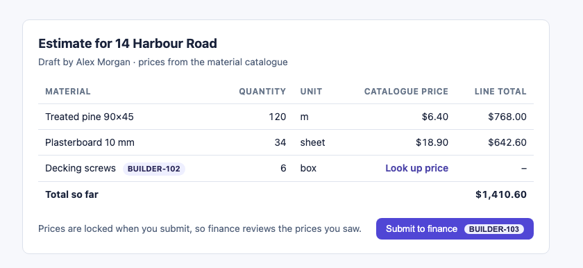

# Plan: builder workflow

Status: proposed. The work is BUILDER-102 and BUILDER-103 in the **Builder workflow** release of the map. None has an agreed estimate yet.

This is the example delivery plan that [Write a delivery plan](story-map.md#write-a-delivery-plan) describes. The stories it refers to are in the sample map at [`test/fixtures/builder-estimates.yaml`](https://github.com/duncan-m/auto-story-map/blob/main/test/fixtures/builder-estimates.yaml), which the package's tests use. Track the release assignments and delivery status in the map, not here.

## Builder workflow

Builders price their estimates by emailing finance, so an estimate waits days for prices, and finance often returns it because a unit price was typed wrong. This release lets builders look up prices themselves and send the estimate for approval, so finance reviews the prices the builder saw.

Items are numbered in the order they should be built:

1. [Look up prices in the material catalogue](#1-look-up-prices-in-the-material-catalogue) (BUILDER-102)
2. [Submit the estimate to finance](#2-submit-the-estimate-to-finance) (BUILDER-103)

BUILDER-102 comes first, because a submitted estimate needs its prices.

## What it builds on

In progress:

- **BUILDER-101**, Draft an estimate against a project: the estimate and its material lines, with quantities and units. Both items add to that screen rather than building their own. It is not merged yet, so BUILDER-102 starts once its line model is.

Planned, and overlapping:

- **FINANCE-201**, Approve an estimate and create a purchase order, in **Finance follow-up**: reads what BUILDER-103 submits. BUILDER-103 defines the submitted estimate, and FINANCE-201 follows it.

Find these with `story-map stories --query estimate --status all` and `story-map story BUILDER-101`.

## 1. Look up prices in the material catalogue

BUILDER-102. A builder picks a material on an estimate line and the catalogue fills in its unit price, so nobody types a price by hand. The price on the line is the catalogue's price on the day it was looked up. A line whose material is not in the catalogue keeps a price field to fill in, marked as entered by hand.

Done when a builder can price every line from the catalogue, and a catalogue change after the lookup does not change the line until the builder looks it up again.

## 2. Submit the estimate to finance

BUILDER-103. **Submit to finance** locks the estimate's prices and puts it in the finance review queue. Finance sees the prices the builder saw, with the hand-entered ones marked.

Done when a submitted estimate appears in the queue with its locked prices, and the builder can no longer change it.

## UI mockup

The estimate screen from BUILDER-101, with the catalogue lookup on a line (BUILDER-102) and the submit button (BUILDER-103).

The mockup is [`example-builder-estimate-mockup.html`](example-builder-estimate-mockup.html), using the board's colour tokens from `styles.css`. To regenerate the image, open it in a browser at 840 by 386 pixels and take a screenshot, or run Chrome headless with `--window-size=840,386 --screenshot`.

## Decisions to make

| Question | Proposal |
| --- | --- |
| A. When a price is locked | On submit, not on lookup, so a builder can refresh prices while drafting |
| B. Lines with no catalogue material | Allowed, with the price marked as entered by hand, so an estimate is never stuck on a missing material |

## Not now

- **Duplicate approvals** (FINANCE-202): when an approval is retried, finance handles it by hand until volumes justify a feature. The sample map cuts the story, with that reason.
- **Price history on a line**: showing how a material's price changed since the lookup. Useful later, but nobody has asked for it.

## Effort and release fit

| Story | Points |
| --- | --- |
| BUILDER-102: Look up prices in the material catalogue | not agreed |
| BUILDER-103: Submit the estimate to finance | not agreed |
| **Total** | **not agreed** |

Neither story has an agreed estimate, so the team should size them in review. Both are needed for the release's impact on estimate turnaround, so neither can move to **Finance follow-up**.
