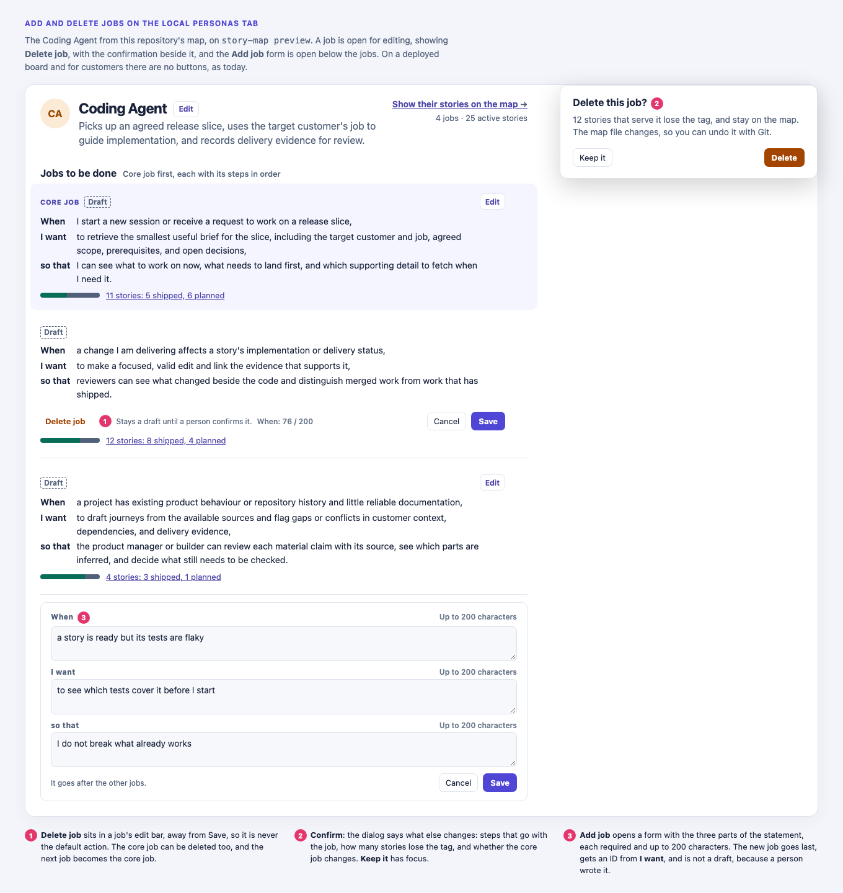

# Plan: add and delete jobs on the local Personas tab

Status: merged. The work is ESM-154 in the **0.7.6: Triage, readiness and agent access** release of the map. Its estimate is agreed: 3 points.

ESM-147 lets a person reword a persona's jobs on the local Personas tab, but adding a job or removing one still means editing the YAML. Reviewing an agent's drafted persona often ends with "this job is not real" or "they also need to…", so the tab should handle both.

It builds on **ESM-147**, [Edit personas in place on the local preview](edit-personas.md#change), merged, whose plan left adding and removing jobs for a later story. The new operations go through the same save handler as the other persona edits. **ESM-155**, [Add a persona on the local Personas tab](add-persona.md#change), follows on with new personas. Deleting personas and adding or removing steps stay in the YAML.

It also fixes two ESM-147 bugs found while testing in a host app:

- **Add did nothing** in Uses today and Constraints. The new row came from a `<template>`, and when React renders the board in the browser it puts a template's children in the DOM rather than its content, so there was nothing to copy. Add now copies a row that is already there. It also stops at the list's limit, rather than letting a save fail with "Too big", and **Cancel** puts back rows that were added or removed.
- **Constraint bullets were missing.** The list relied on the browser's default bullets, which a host's CSS reset can remove. `styles.css` now sets them.

## UI mockup

The mockup is [add-delete-jobs-mockup.html](add-delete-jobs-mockup.html), built on the real `styles.css` with the Personas tab markup the preview renders for this repository's map. To refresh the image, open it in a browser at 1360 px wide and take a full-page screenshot. ESM-154 links to this section from its `sources`.

What it shows:

1. **Delete job** sits in a job's edit bar, at the start, away from **Save**. The core job can be deleted too.
2. **Confirm**: a dialog says what else changes: the job's steps go with it, how many stories lose its tag (they stay on the map), and, for the core job, that the next job becomes the core job. **Keep it** has focus.
3. **Add job**, below the jobs, opens a form with the three parts of the statement, each required and up to 200 characters. It is hidden when the persona has 8 jobs, the schema's limit.

## Change

- **Edit operations** in `src/edit.ts`:
  - `create-job` (`persona`, `situation`, `motivation`, `outcome`, optional `id`) adds the job after the persona's other jobs, so the core job never changes. Without `id`, `jobIdFor` makes one from the first words of **I want**, without a leading “to”, and adds `-2`, `-3` and so on when another job has it. It is not marked `draft`, because a person wrote it. A ninth job is refused.
  - `delete-job` (`job`) removes the job and its steps, removes `jobs` when it was the persona's last, and removes the job's ID from every story's `jobs`, keeping the stories and their other fields.
  Both keep comments and untouched lines, like the other edits.
- **Endpoint**: `personaEditOperations` gains both, so `createStoryMapEditServer` accepts them with its existing checks.
- **Board** (`src/react.tsx`, `board.js`): with `personaEditing`, the jobs section ends with **+ Add job**, which opens a form posting `create-job`. Each job's edit bar starts with **Delete job**, which opens the confirmation and posts `delete-job`. Both reload the tab like other edits.
- **Docs**: the guide's [Edit personas on the local preview](../story-map.md#edit-personas-on-the-local-preview) describes both.

## Left out

- **Reordering jobs.** Choosing the core job deserves its own control and a diff someone reads.
- **Undo on the page.** The change is a normal edit to the map file, so Git undoes it.
- **Job IDs that were deleted.** Nothing records them, so a later job can get the same ID. Stories no longer point at the deleted one, so nothing is confused, but a reviewer reading old PRs may be.
