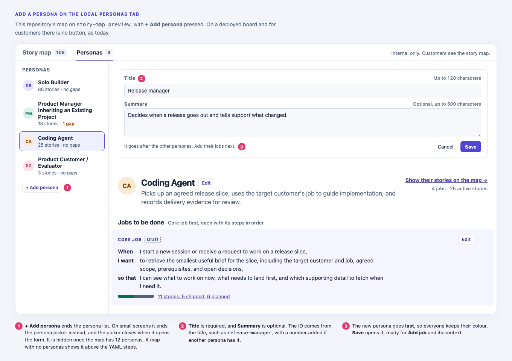

# Plan: add a persona on the local Personas tab

Status: merged. The work is ESM-150 in the **0.7.6: Update the map from the board** release of the map. It has no agreed estimate yet.

ESM-149 lets a person add and delete a persona's jobs on the local Personas tab, but a new persona still has to be typed into the YAML first. This adds a button for it, so a builder can sketch who the product serves without leaving the board, and an empty Personas tab can be filled in from the tab itself.

It builds on **ESM-149**, [Add and delete jobs on the local Personas tab](add-delete-jobs.md#change), merged, which it follows straight on from: a new persona opens ready for **Add job**. It also builds on **ESM-146**, Show how to set up personas on an empty Personas tab, merged, whose YAML steps stay beside the new button. The operation goes through the same save handler as the other persona edits, so a host board that sets up that handler gets it too.

## UI mockup

The mockup is [add-persona-mockup.html](add-persona-mockup.html), built on the real `styles.css` with the Personas tab markup the preview renders for this repository's map. To refresh the image, open it in a browser at 1360 px wide and take a full-page screenshot. ESM-150 links to this section from its `sources`.

What it shows:

1. **+ Add persona** ends the persona list. On small screens, where the list becomes a picker, it ends the picker, which closes when the form opens. It is hidden once the map has 12 personas, the schema's limit. On a map with no personas, it sits above the YAML steps, with "Or add them to the map file".
2. **Title** is required, up to 120 characters, and **Summary** is optional, up to 500. The ID comes from the title.
3. The new persona goes **last**, so every persona keeps its colour, and **Save** opens it.

## Change

- **Edit operation** in `src/edit.ts`: `create-persona` (`title`, optional `summary` and `id`) appends the persona to `personas`, creating the list before `activities` when the map has none. Without `id`, `personaIdFor` makes one from the first words of the title, adding `-2`, `-3` and so on when another persona has it. An empty summary is left out. A thirteenth persona is refused. The result's new `addedPersonaIds` names the ID it chose.
- **Endpoint**: `personaEditOperations` gains `create-persona`, and the save handler's response includes `addedPersonaIds`.
- **Board** (`src/react.tsx`, `board.js`): with `personaEditing`, **+ Add persona** appears in the persona list and the picker, both opening one form at the top of the persona's page. After a save, board.js opens the new persona's page, keeping the other filters. The empty Personas tab gets the same button and form.
- **Docs**: the guide's [Edit personas on the local preview](../story-map.md#edit-personas-on-the-local-preview) describes it.

## Left out

- **Context and jobs in the same form.** The persona's page already has **Add job** and an **Edit** on each context card, so the form stays short.
- **Deleting a persona.** Stories point at personas directly and through their jobs, so removing one needs its own confirmation and rules. It can follow as a story.
- **Reordering personas**, which changes everyone's colours.
- **Customer copy**, which needs approval.
