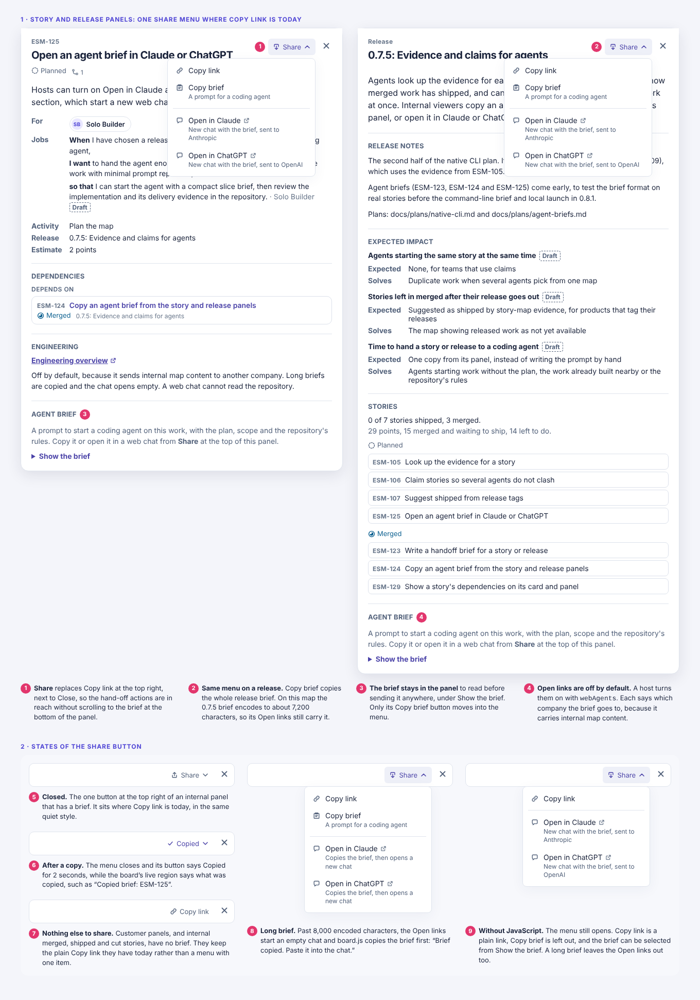
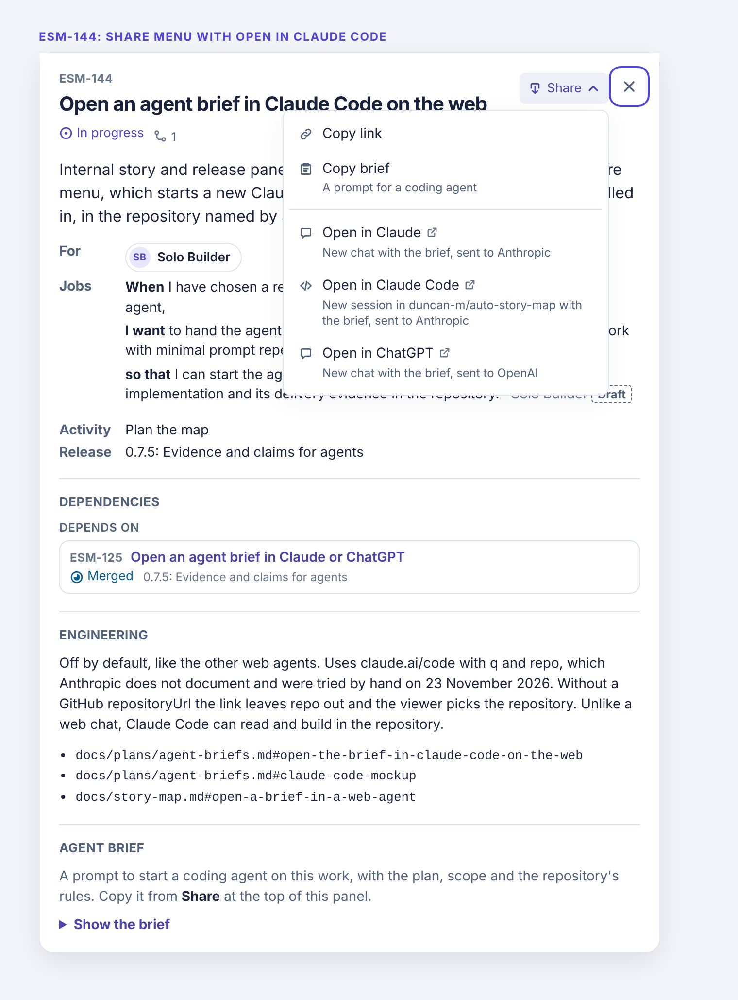

# Plan: hand a story or release to a coding agent

Status: shipped. ESM-123, ESM-124, ESM-125 and ESM-144 shipped in 0.7.5, and ESM-126, from 0.7.10, in 0.7.11. ESM-127, starting a local agent, was cut. The work was split across two releases of the map, so that copying a brief and opening it in a web agent could test how briefs work in practice before the command-line brief.

- **0.7.5: Evidence and claims for agents**: ESM-123, ESM-124, ESM-125 and ESM-144
- **0.7.10: Agent briefs**: ESM-126 and ESM-127

The estimates below are agreed.

Items are numbered in the order they should be built:

1. [Write a handoff brief for a story or release](#1-write-a-handoff-brief-for-a-story-or-release) (ESM-123)
2. [Copy the brief from the panel](#2-copy-the-brief-from-the-panel) (ESM-124)
3. [Open the brief in a web agent](#3-open-the-brief-in-a-web-agent) (ESM-125), and [in Claude Code on the web](#open-the-brief-in-claude-code-on-the-web) (ESM-144)
4. [Write briefs from the command line](#4-write-briefs-from-the-command-line) (ESM-126)
5. [Start a local agent from the preview](#5-start-a-local-agent-from-the-preview) (ESM-127)

The plan grew out of a review of an outside proposal for "copy prompt" and "build in a new thread" buttons. What was left out, and why, is in [Not now](#not-now).

## Why

Two jobs on the map ask for this, and nothing serves them yet:

- The Solo Builder's `plan-and-build` job: "I can start the agent with a compact slice brief, then review the implementation and its delivery evidence in the repository."
- The Coding Agent's `pick-up-work` job: "retrieve the smallest useful brief for the slice, including the target customer and job, agreed scope, prerequisites, and open decisions."

Today a person picking up a story writes the prompt by hand: the story ID, where its plan is, what already exists, what not to build yet and the repository's rules. The map already holds all of it.

## What a brief is

A brief is a short Markdown prompt with tagged sections. It assumes the agent can read the repository, so it **points to files and commands instead of copying them**. The persona constraints on the map ask for this: start with a compact brief and fetch supporting detail as needed.

Every field comes from the map. Nothing is invented: stories have no acceptance criteria field, so the brief links the plan in the story's `sources` and asks the agent to meet it.

| Section | Contents | From |
| --- | --- | --- |
| `<rules>` | Follow `AGENTS.md`. Set each story to `in-progress` with `story-map edit` when work on it starts. The branch name. Name the story ID in commits, the PR title and test names. Build only the target. Do not set estimates or remove `draft` | Fixed text, with the branch name worked out from the target |
| `<target>` | Each story to build: ID, title, status, release, activity, estimate, summary, sources, personas and jobs, and the `story-map story <ID>` command for the rest | The stories |
| `<context>` | Documents to read first, the stories already built nearby to reuse, and the stories nearby not to build yet | The engineering overview link, and the neighbouring stories |
| `<in_flight>` | Work that has already started on a target: tagged tests, and pull requests or commits that name it. Left out when there is none | The tests index (ESM-801) and the changes in the history file (ESM-121), on the board. `story-map evidence` (ESM-105), on the command line |
| `<open_decisions>` | Draft jobs, a missing estimate or plan link, and blocked stories in the same release with their reason | The stories and their jobs |
| `<done_when>` | The plan is met, with tagged tests, `npm run validate` and the tests pass, and the PR has the `story-map diff` summary | Fixed text, using the validation command for this repository or a host |

An example for ESM-111, about 2.5 KB:

```markdown
Build story ESM-111 from the Auto Story Map story map in this repository. Read the files linked below before you change anything.

<brief map="product/story-map.yaml" scope="story" generated="story-map brief ESM-111">

<rules>
- Follow AGENTS.md. It covers the story map, branch, commit, PR and test-naming rules.
- Before your first code change, run `npx story-map edit ESM-111 --status in-progress --write` and commit the change with your work.
- Branch: `feat/esm-111-show-edit-command`. Name ESM-111 in every commit, and start the PR title with "ESM-111: ".
- Start each new test's name with "ESM-111: ".
- Build only the target story. Stories under "Not yet" are out of scope.
- Do not set or change an estimate. Ask before you remove `draft` from anything.
</rules>

<target>
ESM-111  Show the edit command in the story panel
  status: planned · release: v0-7-6 (0.7.6: PM improvements) · activity: explore (Explore the board) · estimate: 3 pts
  summary: The internal story panel has status, reason and release pickers that build the matching story-map edit command, with a button to copy it.
  plan: docs/plans/local-triage.md#2-change-status-and-release-from-the-story-panel
  for: founder (Solo Builder) · jobs: triage-backlog, get-oriented (core job)
  details: npx story-map story ESM-111
</target>

<context>
Read first:
- docs/ENGINEERING-OVERVIEW.md: architecture and the behaviour to preserve
- docs/story-map.md: map rules

Already built in this activity. Reuse it, do not rebuild it:
- ESM-122 (merged)  Link to a story or release with a permalink
- ESM-912 (merged)  Open story details in a panel from the right
- ESM-744 (merged)  Propose map edits from the command line
- ESM-306 (shipped) Open story details without client-side JavaScript

Not yet. Do not build these:
- ESM-112 (planned, same release)  Save status and release changes from the local preview
- ESM-108, ESM-113, ESM-115 (planned, same release)
</context>

<open_decisions>
- Jobs triage-backlog and get-oriented are draft. Treat them as intent, not agreed scope.
</open_decisions>

<done_when>
- Every point in the linked plan section is met, with tests named "ESM-111: …".
- `npm run validate` and `npm test` pass.
- The PR description includes the `npx story-map diff origin/main` summary.
</done_when>
</brief>
```

## 1. Write a handoff brief for a story or release

`storyMapBrief(view, { story })` and `storyMapBrief(view, { release })`, in a new `src/brief.ts` and exported from the root entry point, return the brief as a string. They take the internal projection and refuse a customer view, as the exports do, because a brief carries internal notes, estimates and draft jobs.

**What is included.** Neighbours are limited so the brief stays short. The agent asks for more with `story-map story` or `stories`.

| Scope | Target | Already built | Not yet |
| --- | --- | --- | --- |
| Story | The story | Up to 5 merged or shipped stories in the same activity, the most recently changed first | Planned stories in the same activity, in the same release or later |
| Release | Every planned, in-progress or blocked story in the release, ordered by activity left to right, then by their order in each cell | Merged and shipped stories in the release before | Planned stories in the release after |

Cut stories are left out. A blocked story in the same release is listed under open decisions with its `statusReason`, not as a target. For a release, the rules say to set each story to `in-progress` when work on it starts, not all at once, so the board does not show work as started before it is.

**Branch name.** Worked out in code, so the naming rule in `AGENTS.md` is applied once and tested: `feat/<story ID>-<first words of the title>` for a story, such as `feat/esm-111-show-edit-command`, and `feat/<release ID>-<first words of the title>` for a release. Lower case, letters, digits and hyphens only, and at most 50 characters. The brief names the branch and the agent creates it. Nothing here touches Git.

**In flight.** A brief that sends an agent to start a story someone has already started causes duplicate work. So the brief lists what the board already knows about each target: the tests tagged with its ID, and the merged pull requests and commits that name it. This uses data the host already passes to the board, with no Git reads, because the board renders on the host's server without a checkout. The command line adds branches and claims in item 4.

**Safe text.** Story text is written through pull requests, but a title or note could still contain `</target>` or a line that looks like a rule. Text from the map is put on its own indented lines, with `<` and `>` escaped, so it cannot close a section or add one.

**Size.** A story brief should stay under 4 KB and a release brief under 16 KB. Past that, the "Already built" and "Not yet" lists are cut down first, with a line that says how many were left out. The targets are never cut.

Estimate: 5 points, agreed.

## 2. Copy the brief from the panel

The internal story panel and release panel get an **Agent brief** section, next to **Copy link** from ESM-122.

- **Without JavaScript**, the section is a closed `<details>` with the brief in a `<pre>` block, so it can be selected and copied by hand, like the rest of the panel.
- **With `board.js`**, a **Copy brief** button copies it and says what was copied, such as "Copied brief: ESM-111" or "Copied brief: 0.7.5, 6 stories", the same way **Copy link** says "Copied".
- **Internal only.** The customer view never renders the section, and a test checks this.

The brief is rendered into each panel's HTML on the server. On this map that adds about 2.5 KB per story panel. If that makes large boards slow, the fallback is to load each brief from the host's JSON route when its panel opens (see [Decisions to make](#decisions-to-make)).

Estimate: 2 points, agreed.

## 3. Open the brief in a web agent

The panel's actions move into one **Share** menu, where **Copy link** is today, at the top right next to Close. It holds **Copy link**, **Copy brief**, and, when the host turns them on, **Open in Claude** and **Open in ChatGPT**. The Open links start a new chat with the brief filled in, using `https://claude.ai/new?q=` and `https://chatgpt.com/?q=`. Both were tried by hand on 23 November 2026 with the ESM-111 example above, at about 3,500 encoded characters, and filled in the prompt.

- **Why a menu.** The brief section is at the bottom of the panel, under the notes and sources, so its buttons are out of sight when the panel opens. Copy link is already a hand-off action at the top. One menu keeps them together and adds one control to the header, not three.
- **Only when there is more than one action.** Customer panels, and internal merged, shipped and cut stories, have no brief. They keep the plain **Copy link** they have today, rather than a menu with one item.
- **The brief stays in the panel.** The **Agent brief** section keeps **Show the brief**, so people can read what they are about to send, and copy it by hand without JavaScript. Its **Copy brief** button moves into the menu.
- **Built on the board's menus.** The menu is a `details.esm-menu`, like Export, so it opens without JavaScript. `enhanceStoryMapMenus` closes it on Escape, a click elsewhere or a choice, buttons included. After a copy, the menu button says **Copied** for 2 seconds, and the live region says what was copied, such as "Copied brief: ESM-125".
- **Off by default.** A host turns the Open links on with a `webAgents` board prop, such as `webAgents={["claude", "chatgpt"]}`. Opening one sends internal map content to another company, so it is the host's choice, and each link says which company it goes to. The demo turns both on.
- **Plain links.** Each is an `<a target="_blank" rel="noopener noreferrer">` with the brief encoded in its `href`, so it works without JavaScript.
- **Long briefs.** When the encoded link would be longer than 8,000 characters, the link opens a new chat with no prompt and `board.js` copies the brief first, saying "Brief copied. Paste it into the chat." Without JavaScript, the link is left out and the brief can still be copied by hand. On this map, the 0.7.5 release brief encodes to about 7,200 characters, so release panels usually keep the full link.
- **A web chat cannot read the repository.** The brief points to files rather than including them, so a web agent can plan, review and ask questions about a story but not build it. Item 5 covers building.
- The list of agents is fixed in the library. Other web agents can be added once someone has checked that their prompt parameter works.

Estimate: 2 points, agreed before the Share menu. Moving Copy link and Copy brief into the menu changes the merged work from ESM-122 and ESM-124, so the estimate needs agreeing again.

### UI mockup



The mockup, made before the build, is [panel-actions-mockup.html](panel-actions-mockup.html), built on the real `styles.css` and the board's real markup, rendered from this product's map with briefs turned on and no status history. The Open links carry the real encoded briefs. The Share menu, the brief section without its Copy brief button, and their styles at the top of the file are proposed. To refresh the image, open it in a browser at 1360 px wide and take a full-page screenshot. ESM-125 links to this section from its `sources`.

### Open the brief in Claude Code on the web

ESM-144 adds **Open in Claude Code** to the Share menu. It builds on ESM-125, which a web chat cannot build from because it cannot read the repository. Claude Code on the web runs in a checkout of the repository, so it can do the work the brief describes.

- **The address.** `https://claude.ai/code?repo=<owner>/<name>&q=<brief>` starts a new Claude Code session in that repository with the brief filled in. These parameters are not documented. They were tried by hand on 23 November 2026: the short prompt and the full ESM-111 brief, at about 3,900 encoded characters, both filled in; `repo` picked the named repository for two repositories the owner had not used recently; and a repository that does not exist opened a session with no repository picked. The documented `claude-cli://open` link, which opens the terminal app, was not chosen because it needs Claude Code installed and set up on the viewer's computer.
- **The repository comes from `repositoryUrl`.** When the board's `repositoryUrl` is a GitHub address, the link adds `repo=<owner>/<name>`, such as `duncan-m/auto-story-map`. For other hosts, or without `repositoryUrl`, it leaves `repo` out and the viewer picks the repository. A full GitHub address in `repo` also worked, but `owner/name` is the form to rely on.
- **Off by default, like the others.** A host turns it on with `webAgents={["claude-code"]}`. The hint names the repository and the company, such as "New session in duncan-m/auto-story-map with the brief, sent to Anthropic", and the link has a code icon rather than the chat icon.
- **Long briefs** work as for the other agents: past 8,000 characters the link opens an empty session in the repository, and board.js copies the brief first.
- **If the parameters change**, the link still opens Claude Code, just without the prompt or repository. **Open in Claude** stays as its own option.

Estimate: 1 point, agreed. It reuses the Share menu, the long-brief fallback and board.js from ESM-125.

### Claude Code mockup



The mockup is [open-in-claude-code-mockup.html](open-in-claude-code-mockup.html), rendered with the real board and `styles.css` from this product's map, with briefs, `repositoryUrl` and all three web agents turned on. ESM-144 is shown as in progress, because merged stories have no brief. To refresh it, render the panel again and take a full-page screenshot at 760 px wide. ESM-144 links to this section from its `sources`.

## 4. Write briefs from the command line

`story-map brief` prints the same brief for agents and scripts, and adds the scopes that are too long for a panel:

```bash
npx story-map brief ESM-111
npx story-map brief ESM-111 ESM-112
npx story-map brief --release v0-7-6
npx story-map brief --activity explore
```

- `--activity <ID>` targets the activity's planned and in-progress stories, ordered by release from top to bottom, with its merged and shipped stories as "Already built".
- `--full` includes each target's notes, persona context and tagged tests inline, for agents that cannot run commands.
- `--format json` prints the same sections as JSON.
- **In flight from Git.** The `<in_flight>` section adds what `story-map evidence` (ESM-105) finds for each target: branches that name it, commits on the default branch, claims (ESM-106) and broken sources. The brief calls the evidence code rather than reading Git a second time, so the two stay consistent.
- When the MCP server from ESM-116 exists, it gets a `get_brief` tool that wraps this command.

This is why this item is in 0.7.10: it comes after evidence and claims in 0.7.5, after the MCP server in 0.7.6, and after the brief format has been tested from the panel in 0.7.5.

Estimate: 3 points, agreed.

## 5. Start a local agent from the preview

In `story-map preview --writable` (ESM-112), the panel's brief section gets a **Build ▾** button that starts Claude Code or Codex in the repository with the brief as its first message. The choice of agent is remembered in the browser.

- **The page never sends the prompt.** It sends only the scope, the story or release ID and the agent name to `POST /api/story-map/launch`. The preview builds the brief itself from the map on disk, so a page cannot make it run arbitrary instructions.
- **Same checks as saving edits:** loopback address only, an `Origin` header that matches the preview, a JSON content type and the start-up token from ESM-112.
- **A fixed list of commands.** The agent name picks one of two commands built into the library, run with `execFile` and an argument array, never through a shell. The exact arguments for `claude` and `codex` are checked when this is built.
- **No Git changes.** The brief names the branch, and the agent creates it.

Estimate: 5 points, agreed. It depends on ESM-112 in 0.7.6.

## Briefs and evidence

`story-map evidence` (ESM-105) and the brief both gather facts about a story for an agent, but they answer different questions:

| | Evidence (ESM-105) | Brief (ESM-123) |
| --- | --- | --- |
| Question | What has already happened on this story? | What should the agent do next, and within what limits? |
| Reads | Git branches and commits, plans, tests, broken sources and claims | The map: the story, its neighbours, jobs and sources |
| Output | Facts, with a suggested status | A prompt with rules, scope, what to reuse and what not to build |
| Used by | The scheduled audit (ESM-109), reviewers and the MCP server | The panel's Share menu, `story-map brief` and Build |
| Runs | On the command line, in a checkout | On the board too, without Git |

The brief uses evidence where it can, in its `<in_flight>` section, and never repeats evidence's Git reads. The handoff serves the Coding Agent's `pick-up-work` job. Evidence serves the audit and the Product Manager's `validate-inherited-map` job.

## Architecture decisions

Following [Record architecture decisions](../ENGINEERING-OVERVIEW.md#record-architecture-decisions). ESM-123 to ESM-125 and ESM-144 have shipped, ESM-126 has merged and ESM-127 was cut, so these answers record what was built.

- **Where it runs.** Inside the existing package: `storyMapBrief` in `src/brief.ts`, the board's panels, `board.js` and the CLI's `brief` command. No service, worker or bridge package. The [Not now](#not-now) list says why a localhost bridge was not built.
- **Data and contracts.** Upstream, the brief reads the internal projection, the tests index, the changes in the history file and, on the command line, `story-map evidence`. Downstream, `storyMapBrief` is a new export from the root entry point, the brief's tagged sections are a format agents read, the board gains the `webAgents` prop and the Share menu, and `brief --format json` is a new CLI output. The Open links send the brief to Anthropic or OpenAI.
- **Boundaries.** [Exports are internal only](../ENGINEERING-OVERVIEW.md#security-boundaries-to-preserve): the brief refuses a customer view, like the exports. Map text is escaped so it cannot close or add a brief section. Sending a brief to a web agent takes internal map content outside the host, so it is off until the host turns it on with `webAgents`. ESM-127's launch endpoint, which would have started a process from the preview, was cut, so no boundary for running commands was added.
- **Reversibility.** The panel section and the Share menu can be removed in a release. `storyMapBrief`, the `webAgents` prop and the brief format are public, so removing them is a breaking change for hosts and agents that use them. The Open links depend on `claude.ai` and `chatgpt.com` parameters that are not documented, and they degrade to an empty chat if those change.

Consequential decision, recorded after the build: letting a host send briefs to web agents run by other companies (ESM-125, ESM-144). Consumers: hosts that turn on `webAgents`, and their viewers, whose internal map content goes to Anthropic or OpenAI. Alternative considered: a localhost bridge that starts an agent, not built for the reasons in [Not now](#not-now). Agreed by: the plan records the agreed estimates but not who agreed the decision itself, so this is a **proposal** for a person to confirm before it moves to the engineering overview. Revisit if the undocumented parameters stop working, or a host needs a web agent that is not on the fixed list.

## Decisions to make

These are proposals. Each is easy to change during review.

| Question | Proposal |
| --- | --- |
| A. Where the brief for each panel comes from | Rendered into the panel on the server. Change to loading it from the host's JSON route only if large boards turn out slow |
| B. How Build runs an interactive agent | The preview is a server with no terminal of its own. The options are opening a new terminal window, which works differently on macOS, Linux and Windows; running the agent headless and showing its output in the preview; or printing the command in the terminal that runs the preview. Decide with a spike at the start of ESM-127 |
| C. Branch prefix | `feat/` for story and release work. `AGENTS.md` examples use `fix/` and `docs/`, which stay for that kind of work |

## Not now

- **A stack profile on the board** (framework, folders, test commands). The agent is already in the repository, with `AGENTS.md` and its manifest. A copy in the map would drift.
- **A separate localhost bridge package.** A server that hosted pages can post prompts to would let any website start an agent in your repository unless it had the same locks as ESM-112. The local preview already runs in the repository with those locks, and browsers increasingly block public pages from calling localhost.
- **Agent threads or cloud workers inside the board.** They need a backend, LLM keys and storage, and the board never handles HTTP or storage itself.
- **Status updates from a webhook.** The brief tells the agent to set `in-progress` with `story-map edit`, and the commits, pull requests and tests that name the story show up on its panel through ESM-120, ESM-121 and ESM-801.

## Effort and release fit

| Story | Release | Points |
| --- | --- | --- |
| ESM-123: Write a handoff brief for a story or release | 0.7.5 | 5, agreed |
| ESM-124: Copy an agent brief from the story and release panels | 0.7.5 | 2, agreed |
| ESM-125: Open an agent brief in Claude or ChatGPT | 0.7.5 | 2, agreed |
| ESM-144: Open an agent brief in Claude Code on the web | 0.7.5 | 1, agreed |
| ESM-126: Write agent briefs from the command line | 0.7.10 | 3, agreed |
| ESM-127: Start Claude Code or Codex on a brief from the local preview | 0.7.10 | 5, agreed |

ESM-123 to ESM-125 depend on nothing else in 0.7.5, so they can be built before or alongside the evidence and claim work. ESM-126 uses the evidence code from ESM-105.
