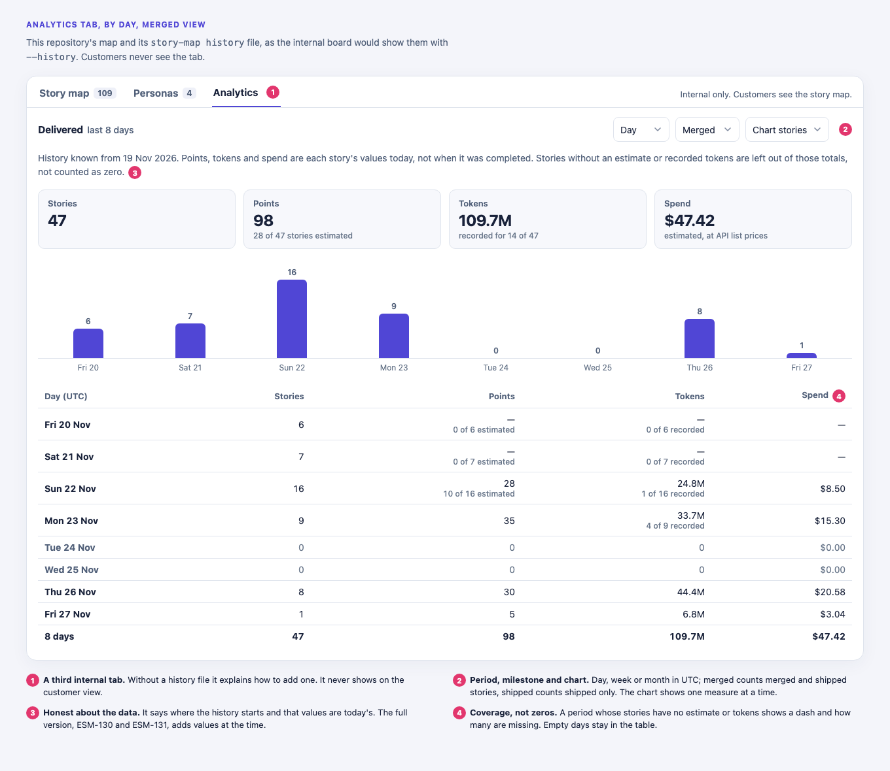

# Plan: Git-native delivery metrics

Status: proposed. Planning only; no implementation in this PR. Work is split into two releases:
- **0.8.2: Delivery visibility** — a spike first, ESM-174, then the full version, ESM-130 through ESM-134.
- **0.8.3: Delivery intelligence** — ESM-135, ESM-136 and ESM-138.

0. [Spike: show delivery totals in an Analytics tab](#spike-show-delivery-totals-in-an-analytics-tab) (ESM-174)
1. [Reconstruct delivery events from Git](#1-reconstruct-delivery-events-from-git) (ESM-130)
2. [Calculate historical scope and completion](#2-calculate-historical-scope-and-completion) (ESM-131)
3. [Show burn-up and burn-down in Analytics](#3-show-burn-up-and-burn-down-in-analytics) (ESM-132)
4. [Report throughput and velocity](#4-report-throughput-and-velocity) (ESM-133)
5. [Summarise delivery on each release lane](#5-summarise-delivery-on-each-release-lane) (ESM-134)
6. [Measure lead time](#6-measure-lead-time) (ESM-135)
7. [Baseline releases and expose scope changes](#7-baseline-releases-and-expose-scope-changes) (ESM-136)
8. [Display cumulative flow and bottlenecks](#8-display-cumulative-flow-and-bottlenecks) (ESM-138)

The team agreed estimates for 0.8.2 (27 points): ESM-130 5, ESM-131 8, ESM-132 8, ESM-133 3 and ESM-134 3. For 0.8.3 (18 points): ESM-135 5, ESM-136 5 and ESM-138 8. ESM-174 has no estimate yet: the team needs to agree one. Estimates must be agreed before adding them to the map. All metrics are internal-only by default; no new tracking ceremony, server or mandatory database.

## Why and product outcome

The Solo Builder needs to know what is done, what remains and whether a release is on track without maintaining sprint tickets. A PM inheriting a project needs a credible delivery baseline, including where historical evidence is incomplete. Git and `product/story-map.yaml` already hold much of this information, but the board does not expose trends.

Success: a user can open a release, see delivered versus changing scope, throughput and missing history, and use those observations to choose the next useful slice. Calculations are reproducible from the repository, not generated by an LLM.

## Measurement contract (applies to every story)

- **Completion:** every view names its milestone, `merged` (engineering completion) or `shipped` (customer availability). The merged view counts stories that are `merged` or `shipped`, since shipping comes after merging; the shipped view counts `shipped` only. A story that moves from `merged` to `shipped` is counted once in each view.
- **Scope:** a release's active scope excludes `cut` stories; show cuts and additions as explicit scope-change events, not as completed work. Historical scope and point totals use values *at the time*, not today's estimates.
- **Units:** stories always supported; story-point charts only use stories with agreed estimates. Label the fraction missing an estimate and never treat missing estimates as zero. No invented estimates.
- **Timing:** derive transitions from Git commits that changed the map, not PR creation dates or file modification time. Treat history before the first observable revision as unknown. Shallow clones, squashed history, rewritten commits and backfilled stories may reduce fidelity: display coverage/limitations.
- **Time buckets:** UTC day/week, documented inclusive/exclusive boundaries. Allow 8/12-week windows; zero-activity periods remain visible.
- **Correctness:** renames and release moves must retain a story's stable ID; point changes, status reversions and stories re-opened must not double-count cumulative completion. Document how revisions/backfills affect snapshots.
- **Privacy:** analytics require internal-map permission; customer viewers never receive internal history, point estimates or velocity.
- **Performance:** read Git only when `story-map history` runs, as it does today. Every metric is calculated from the map and the history file, so there is no second generated file and no Git scan per UI request. If a calculation later proves too slow or too large to run in the board, add a precomputed file then.

## Release 0.8.2 — Delivery visibility

The release starts with a spike, ESM-174, which puts a simple delivery report in front of people quickly, using only data the map and the history file already hold. The full version, ESM-130 to ESM-134, follows on from it: it builds on the spike's Analytics tab and calculations rather than starting again, and adds what the spike leaves out, scope change and remaining work.

### Spike: show delivery totals in an Analytics tab

**User story:** As a Solo Builder, I want to see how many stories, points, tokens and how much spend I delivered each day, week or month, so that I can see my delivery pace and what it costs without building a report by hand.

**Scope:** a new internal **Analytics** tab on the board, after **Story map** and **Personas**. A period selector (**Day**, **Week**, **Month**) and a completion selector (**Merged** or **Shipped**), using the milestone rule in the measurement contract. For each UTC period: stories completed, the sum of their `estimate`, the sum of their `tokens` and the sum of their `estimatedCostUsd`, with totals for the window. Show the last 8 days, 8 weeks or 6 months, with empty periods kept. A table is the main view, with a small bar chart of one chosen measure above it; no chart library.

- **When a story was completed:** the time of the status change, in the history file the board already loads with `--history`, that took it into the selected milestone. A story that was reopened and completed again counts once, in the period of its latest completion. A story that is no longer complete is not counted.
- **Values today, not at the time:** points, tokens and spend come from the story as it is in the map now. The tab says so. The full version's ESM-130 and ESM-131 replace this with values at the time.
- **Coverage, not zeros:** each period shows how many of its stories have an estimate and how many have tokens recorded, such as “tokens for 4 of 9”. A story with no estimate or no tokens is never counted as zero. When the history is incomplete, the tab says from what date it is known.
- **No history file:** the tab explains how to add one with `story-map history` and `--history`, and shows nothing else.
- **Internal only:** the tab, tokens and spend never reach a customer view, like the Personas tab.

**Acceptance:** totals match the map and the history file for this repository; reopened stories are counted once; missing estimates and tokens are shown as coverage, not as zero; empty periods appear; the tab, its data and its query parameters are absent from the customer projection; the table is readable by a screen reader and with the keyboard.

**Not in the spike:** scope change, remaining work, burn-up and burn-down, release filters, and values at the time. Those are the full version below.

**Depends on:** the existing `story-map history` file, and the `tokens` and `estimatedCostUsd` fields stories get in the PR that finishes them.

**Follow-on:** ESM-132 adds the burn charts to this tab. ESM-133 becomes a small extension of the spike's table, adding velocity and the 12-week window. ESM-134 links each release lane to the tab.

### 1. Reconstruct delivery events from Git

**User story:** As a Solo Builder or PM inheriting a project, I want the map to reconstruct historical status, estimate and release changes so that trends reflect what was known at each point in time.

**Scope:** add estimate changes, release moves and cut/reinstated changes to the history file that `story-map history` writes, which already records when each story was added and each status change, the commit and pull request behind each change, versions it could not read, and whether the history is complete. Put the new changes in a new optional list rather than in `events`: `parseStoryMapHistory` only accepts `added` and `status` events, so a board from an earlier release would reject the file. Stable ordering for changes that reach the branch in the same commit or at the same time. Record the earliest observable revision alongside the existing `complete` flag.

**Acceptance:** fixture histories cover additions, estimate changes, mid-release moves, deleted/renamed historical paths, re-openings, cut stories, shallow history and events sharing a timestamp. No fabricated events for unknown prehistory.

**Depends on:** the existing `story-map history` reader.

### 2. Calculate historical scope and completion

**User story:** As a PM, I want daily snapshots of total scope, delivered and remaining work for each release so that burn charts reflect changes rather than hiding them.

**Scope:** pure calculations from events and map data, producing story-count and point-based series. Explicit units, completion milestone, missing estimates and scope changes. Define handling of points added to already-completed stories and retroactive edits.

**Acceptance:** invariants hold for each complete snapshot (remaining = active scope - completed within the same units and estimation coverage); scope additions/cuts do not masquerade as delivery. Partial-history series mark the unknown portion.

**Depends on:** ESM-130.

### 3. Show burn-up and burn-down in Analytics

**User story:** As a Solo Builder, I want a clear burn-up or burn-down chart by release so that I can see what is changing and whether work remains.

**Scope:** add to the Analytics tab from ESM-174; default burn-up (completed and total scope); toggle burn-down, story counts/points, release, 8/12 weeks and merged/shipped. Accessible chart labels, table fallback/accessible data, clear empty and insufficient-history states. Calculate the series from the map and the history file the board already loads with `--history`; support optional static/no-JS host rendering patterns.

**Acceptance:** added scope is visible separately from completed work; charts never claim missing history is zero; unestimated work remains visible in count mode.

**Depends on:** ESM-131 and ESM-174.

### 4. Report throughput and velocity

**User story:** As a Solo Builder, I want weekly delivered stories and estimated points so that I can understand my actual delivery cadence without sprints.

**Scope:** extends the spike's weekly table from ESM-174 with story-point velocity at the time and a 12-week window, including zero weeks, same completion selector and explicit denominators/coverage. No individual-agent scoreboards or commit-count proxies.

**Acceptance:** one story contributes at most once to its currently selected completed milestone in a window; status reversals and re-completion have defined behavior, tested with fixtures. Unknown estimates are never silently dropped from story throughput.

**Depends on:** ESM-131 and ESM-174.

### 5. Summarise delivery on each release lane

**User story:** As a Solo Builder, I want release progress shown next to the existing stories so that I can choose the next slice without leaving the map.

**Scope:** completed/total count, progress bar, remaining and blocked counts, all from the current map, so this needs no history. Link to the Analytics tab from ESM-174, and to its release view once ESM-132 lands. Keep the full story map readable and avoid false confidence when history/estimates are missing.

**Acceptance:** progress matches current map and selected completion milestone; blocked and cut states are distinguished; internal-only analytics do not leak through customer projection.

**Depends on:** nothing. It can land first in 0.8.2.

## Release 0.8.3 — Delivery intelligence

### 6. Measure lead time

**User story:** As a Solo Builder, I want to know how long stories take from entering the map to reaching merged and shipped so that I can see how long work waits and distinguish build time from release delay.

**Scope:** lead time from a story's first observed entry in the map to the chosen completion milestone; merged-to-shipped delay as a separate value. Exclude or label stories that entered before the observable history instead of guessing. Cycle time is out of scope: stories rarely reach the default branch as `in-progress`, so the start of work is not observable from the map's history.

**Acceptance:** durations and distribution statistics handle re-openings, blocked periods, entries before the observable history and long-tail outliers with a documented policy.

**Depends on:** ESM-130.

**Estimate:** 5 points, agreed. The calculations are pure functions of the history events from ESM-130, but the distribution statistics and the documented policy for re-openings, blocked periods and unknown prehistory need their own fixtures.

### 7. Baseline releases and expose scope changes

**User story:** As a PM, I want a release's agreed baseline and subsequent changes visible so that I can distinguish evolving scope from slow delivery.

**Scope:** an optional release `baselineDate` schema field, with validation and documented UTC date semantics. Count stories and points added, moved, cut and re-estimated after baseline; no automatic baseline inferred as an approved commitment.

**Acceptance:** the baseline date is optional; release moves are attributed to both affected releases; historical data limitations stay visible; no generated baseline overwrites an agreed one.

**Depends on:** ESM-130 and ESM-131.

**Estimate:** 5 points, agreed. A small schema field with validation and docs, plus scope-change counts built on the ESM-131 series.

### 8. Display cumulative flow and bottlenecks

**User story:** As a PM, I want status inventory and ageing trends so that I can find blocked work and excessive work in progress.

**Scope:** cumulative-flow view by observed status over time, current WIP/blocked ageing, status transition interpretation and filters by release. Prefer actionable story links over individual productivity ranking.

**Acceptance:** every story belongs to only one status at each snapshot; statuses sum to observed inventory; unknown prehistory is labelled; historical reclassifications are handled consistently.

**Depends on:** ESM-130 and ESM-131.

**Estimate:** 8 points, agreed. A new accessible cumulative-flow chart with a table fallback, ageing views and release filters, the most new UI in the release.

## UI mockup

The mockup is [delivery-metrics-mockup.html](delivery-metrics-mockup.html), for the ESM-174 spike. It is built on the real `styles.css` and the board's tab row and toolbar markup, and the Analytics classes are proposed. The numbers are this repository's map and its `story-map history` file on 27 November 2026, by day in the merged view. To refresh the image, take a full-page screenshot at 1360 px wide.

What it shows:

1. **A third internal tab, Analytics,** after **Story map** and **Personas**. ESM-128 plans an **Actions** tab in the same row, so whichever lands second adds itself after the other.
2. **Period, milestone and chart selectors.** The chart shows one measure at a time, and the table below it is the accessible data.
3. **Where the data is limited.** The note says where the history starts and that values are today's.
4. **Coverage, not zeros.** Days whose stories have no estimate or tokens show a dash and how many are missing, and empty days stay in the table.

## Implementation guidance

1. Extend existing history parsing, not a second Git reader. Keep history logic separate from rendering.
2. Write the calculations as pure, deterministic functions of the map and the history file, shared by the board and any CLI output. Do not add a second generated file until a real limitation needs one.
3. Load the history file through the existing host integration (`--history` and the board option) behind the internal-map boundary. Hosts with no Git at runtime already ship a prebuilt history file.
4. Reuse existing styling, keyboard/accessibility conventions, release panel and progressive enhancement. Do not introduce a heavy chart dependency without an evaluated bundle-size justification.
5. Add fixtures and unit tests prefixed with the corresponding ESM ID. Validate docs and map references as part of the normal repository checks.

## Decisions to settle before implementation

- Whether a 'completed' story that subsequently reopens should reduce cumulative burn-up or whether separate net-completed versus ever-completed series should be offered. Proposed default: net-completed, with status history explaining reversals.
- When a story is moved between releases, whether its earlier delivered work appears historically in its old release. Proposed: yes for historical snapshots, with a separate current-scope view.
- Whether Analytics is a top-level tab or a release-specific panel first. Settled by ESM-174: a top-level **Analytics** tab, plus a small release-row summary in ESM-134.

## Not now

Sprint creation, timesheets, manual daily updates, agent leaderboards, cost-per-token dashboards (ESM-174 shows total tokens and spend per period, not cost per token or per agent), server-side data storage, cycle time and completion forecasts. None is necessary to deliver trustworthy Git-native metrics.

## Delivery checklist

- All 9 stories remain `planned` until implementation begins.
- No estimates are assigned without team agreement. The 0.8.2 and 0.8.3 estimates are agreed, except ESM-174's.
- Validate map/schema; add linked tests at implementation time.
- Keep delivery metrics out of customer-facing projections.
- Review usability with a Solo Builder and an inheriting PM before considering the feature shipped.
