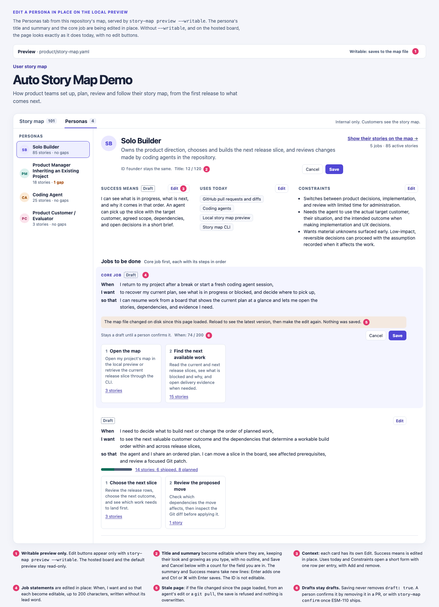

# Plan: edit personas in place on the local preview

Status: shipped. The work is ESM-147 in the **0.7.6: Triage, readiness and agent access** release of the map. Its estimate is agreed: 8 points.

The Personas tab (ESM-911) shows each persona's summary, context and job statements, but changing any of them means finding the right lines in the YAML or asking an agent. Personas are mostly agent drafts waiting for a person to review them, and reviewing usually means rewording: tightening a constraint, sharpening a job's trigger or stake. This plan lets a person do that on the Personas tab itself, in the local preview, without making the hosted board writable.

It sits beside two planned stories in the same release:

- **ESM-112**, [Save changes from the local preview](local-triage.md#3-save-changes-from-the-local-preview): this plan first assumed ESM-112 would build `story-map preview --writable` and its `POST /api/story-map/edit` endpoint. ESM-147 was built first, so it adds both, with the Origin, token and stale-file checks ESM-112 describes, and the endpoint accepts only the persona operations. ESM-112 now adds the status and release operations to the same endpoint rather than building it.
- **ESM-110**, [Confirm drafts from the command line](local-triage.md#1-confirm-drafts-from-the-command-line): confirming a draft stays there. Editing on the page never removes `draft`.

It overlaps nothing shipped. ESM-404, editing on the hosted board, stays cut for the same reason as before.

## UI mockup

The mockup is [edit-personas-mockup.html](edit-personas-mockup.html), built on the real `styles.css` with the Personas tab markup the preview renders for this repository's map. To refresh the image, open it in a browser at 1360 px wide and take a full-page screenshot. ESM-147 links to this section from its `sources`.

What it shows:

1. **Local boards only.** Edit buttons appear on `story-map preview` and the example host, which run on your machine against your checkout. A deployed product's board stays read-only.
2. **Title and summary** become editable where they are, keeping their look, with **Save** and **Cancel** below and a count against the schema limits (120 and 500 characters). The ID is shown but not editable.
3. **Context**: each card has its own **Edit**. **Success means** is edited in place like the summary. **Uses today** and **Constraints** are lists, so they open a short form with one row per entry, and **Add** and remove, up to the schema's limits.
4. **Job statements** are edited in place too: the **When**, **I want** and **so that** parts each become editable, up to 200 characters, written without its lead word.

A first version used a form with text boxes for every part. It hid long text behind a scroll box and looked nothing like the page, so free text is now edited as the text itself, and forms are kept for the two lists.
5. **Stale page**: a save from a page rendered before the file last changed is refused, with nothing written, and the form says to reload.
6. **Drafts stay drafts.** The form says a draft stays one until a person confirms it. `story-map confirm` (ESM-110) is not built yet, so the hint does not name it.

## What can be edited

| Part | Fields | Not editable here |
| --- | --- | --- |
| Persona | `title`, `summary` | `id`, `customer` copy, order |
| Context | `success`, `usesToday`, `constraints` | `draft` |
| Job | `situation`, `motivation`, `outcome` | `id`, `draft`, order (the core job), steps |

Left out on purpose, so this stays one small story:

- **IDs.** Stories follow a persona or job by ID, so renaming one would break them. The guide already says to keep the ID when rewording.
- **Customer copy.** It needs approval, so it stays a PR change.
- **Order.** Reordering jobs changes the core job, and reordering personas changes everyone's colours. Both deserve a diff someone reads.
- **Adding and removing personas, jobs and steps.** Each needs its own form and validation messages. They can follow as stories if this is used.
- **`draft`.** Only a person removes it, through `story-map confirm` on a terminal (ESM-110). The endpoint has no operation that touches it, so an agent that finds the page's token cannot confirm a draft this way either.

## Change

- **Edit operations** in `src/edit.ts`: `set-persona` (`persona`, optional `title`, `summary`), `set-persona-context` (`persona`, optional `success`, `usesToday`, `constraints`) and `set-job` (`job`, optional `situation`, `motivation`, `outcome`). `proposeStoryMapEdit` applies them like the story operations: it keeps comments and untouched lines, keeps `draft` as it was, and returns a validation error rather than a file when a field is empty or over its limit. An empty `usesToday` or `constraints` list removes the key, and a context left with none of the three is refused, since validation needs at least one.
- **Endpoint**: `story-map preview` adds `POST /api/story-map/edit`, as ESM-112 describes: it needs an `Origin` matching the preview, a JSON content type, the start-up token in an `X-Story-Map-Token` header, and the hash of the file the page was rendered from. It listens on the loopback address only, and accepts only `set-persona`, `set-persona-context` and `set-job` until ESM-112 adds its operations.
- **Board** (`src/react.tsx`, `board.js`): with `personaEditing` set, the Personas tab renders an **Edit** button on the persona heading, each context card and each job lane. For the title, summary, success and job parts, board.js makes the text itself `contenteditable` (plain text only), labelled as a text box, with **Save** and **Cancel** below and a live count for the focused field. In the title and job parts **Enter** saves. The summary and success can have more than one line, so there **Enter** adds a line and Ctrl or ⌘ with **Enter** saves, and the tab shows their line breaks. **Escape** cancels. There is no outline on text being edited: the caret and the **Save** bar show where you are. Only changed fields are sent, so text the board shortens, such as an outcome's final full stop, is kept when it is not edited. Uses today and Constraints open a form with one input per entry. One editor is open at a time: pressing **Edit** elsewhere with unsaved changes opens a dialog to **Save** (and open the next part after the reload), **Discard** or **Keep editing**, and leaving the page with unsaved changes uses the browser's own warning. **Save** reloads the tab at the same persona and puts focus back on the **Edit** button. Without JavaScript, or without `--writable`, there are no buttons.
- **Errors**: a validation error shows under the form with the field it names, and the stale-file refusal says to reload. Neither writes the file.
- **Credit**: nothing new. The edit is a normal change to the file, credited to whoever commits it, and `story-map diff` already reports reworded jobs with their full statement and changed context under **Personas and jobs**.

## On by default

The first version needed `story-map preview --writable`. People ran the preview or the example host and found no edit controls, so editing is now on by default wherever the board runs locally: `story-map preview` (with `--read-only` to turn it off, and `--writable` still accepted) and the example host. The save handler moved to `createStoryMapEditServer` in `src/edit-server.ts`, so the preview, the example host and a host's own development server share one set of checks. It now also refuses a non-loopback `Host`, because a host server may not check `Host` itself as the preview does. A deployed product's board stays read-only, because the map file on a server is not the repository.

## Docs

A short **Edit personas on the local preview** section under [Personas and jobs to be done](../story-map.md#personas-and-jobs-to-be-done), linked from the writable preview section that ESM-112 adds. It says what can be edited, that drafts stay drafts, and that the hosted board stays read-only.

## Tests

Name each `ESM-147: …`.

- Each operation changes only its fields, keeps comments and `draft`, and is refused for an unknown persona or job, an empty field or one over its limit.
- Clearing every context field is refused.
- The endpoint refuses persona operations with `--read-only`, a non-loopback `Host`, the wrong Origin or token, and when the file hash is stale, and writes nothing in each case.
- The Personas tab renders no **Edit** buttons with `--read-only`, for customers, or without `personaEditing`.
- Editing a job's statement and saving reloads the tab with the new wording, still labelled **Draft**.

## Estimate

8 points, agreed after it merged.

## Questions for review

- **Release.** It is placed in 0.7.6 beside ESM-112, which it needs. If 0.7.6 should stay as it is, 0.7.7 fits too.
- **Steps.** Rewording a step's title and summary is a small addition to `set-job`. Worth including now, or wait to see if people ask?
