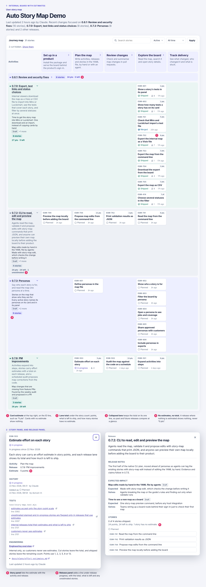

# Plan: effort estimates on stories

Status: in progress. Items 1 and 2 are built. The work is ESM-503 in the **0.7.6: PM improvements** release of the map.

Each story can carry an effort estimate in story points. Each release lane shows the total for the release and how much of it is left to ship, so a product manager can see at a glance whether a release is too big and how far through it the team is.

Items are numbered in the order they should be built, and each section uses the same number. All of them are part of ESM-503:

1. [Add the estimate field](#1-add-the-estimate-field)
2. [Total estimates in the view](#2-total-estimates-in-the-view)
3. [Show estimates on the board](#3-show-estimates-on-the-board)
4. [Diff, exports and the CLI](#4-diff-exports-and-the-cli)
5. [Document it](#5-document-it)

Estimates are internal only. The customer view and customer-facing copy do not change.

## UI mockup

The mockup is [effort-estimates-mockup.html](effort-estimates-mockup.html), built on the real `styles.css` and the board's real markup, rendered from this product's map, status history and tests index, with illustrative estimates. Cards show the test count and when the story last changed, as on a host that supplies both. The estimate markup and its styles at the top of the file are proposed for item 3. To refresh the image, open it in a browser at 1360 px wide and take a full-page screenshot. ESM-503 links to this section from its `sources`.

What it shows:

1. **Card estimate** at the top right, on the same line as the story ID, such as “5 pts”, or “1 pt” for one point. The bottom line keeps the status, test count and last change, so it does not wrap. Cards with no estimate show nothing.
2. **Lane total** under the story count: “24 pts · 24 left · 1 unestimated”.
3. **Collapsed lane**: the total stays on the lane's single line, after the story count.
4. **No estimates, no total**: 0.7.3 has no estimated stories, so its lane shows only the story count.
5. **Story panel**: an **Estimate** row after **Release**.
6. **Release panel**: a line under release progress, “24 points, 24 left to ship. 1 story has no estimate.”

The lane total uses the lane's own ink colour, and the card estimate the muted text and line colours, so the light, dark and system palettes need no new properties.

## Why points

Points add up, and a total on each release is the main reason for the feature. T-shirt sizes are quicker for a first guess, but they need a hidden mapping such as M = 3 before they can be totalled, and the total then reads as points anyway. A fixed Fibonacci-style scale stops arguments over 6 versus 7, and a story above 13 is a sign to split it.

## Decisions to make

These are proposals. Each is easy to change during review.

| Question | Proposal |
| --- | --- |
| A. The field | An optional `estimate` on each story, a number from the scale 1, 2, 3, 5, 8 or 13. Any other value is a validation error. |
| B. The unit | Story points only, labelled “pts”. No per-map unit setting in this round. |
| C. What the total counts | Every story in the release except `cut` ones, because cut stories have left the release. This matches release progress. |
| D. What “left” counts | Stories that are not `shipped` or `cut`. Merged stories still count as left, because their users cannot use them yet. See [open question 1](#open-questions). |
| E. Stories with no estimate | They add nothing to the total, and the total says how many there are, such as “21 pts, 8 left · 2 unestimated”. A release with no estimates shows no total at all. |
| F. Filters | The lane total always counts the whole release, like release progress, so filtering the board does not change it. |
| G. Validation | A warning for a `planned` or `in-progress` story with no estimate, but only in a release where at least one other story has one. Maps that do not use estimates get no new warnings. |
| H. Who sees it | Internal viewers only. The customer projection is an allow-list, so it drops the field without extra code, and a test proves it. |

## Suggested order

| Item | Name | Size | Depends on |
| --- | --- | --- | --- |
| 1 | Add the estimate field | S | — |
| 2 | Total estimates in the view | S | 1 |
| 3 | Show estimates on the board | M | 2 |
| 4 | Diff, exports and the CLI | S | 1, 2 |
| 5 | Document it | S | 1–4 |

Items 1 and 2 can ship in one PR, with ESM-503 set to `in-progress`. Items 3 to 5 can follow in a second PR, which sets ESM-503 to `merged`.

Every PR follows the repository's rules: update `product/story-map.yaml` in the same PR, run `npm run validate` and `npm test`, add a `## Unreleased` entry to `CHANGELOG.md`, and include the `story-map diff origin/main` summary in the PR description. Tests that cover the story start their names with `ESM-503:`.

---

## 1. Add the estimate field

**Change.** Follow [Add a field to the map](../ENGINEERING-OVERVIEW.md#add-a-field-to-the-map):

- Add `estimate` to the story schema in `src/schema.ts`, as an optional union of the six allowed numbers, with a `.describe()` text naming the scale. Export the scale as `estimatePoints` so the board, validator and docs share one list.
- Add the warning from decision G in the same pass that warns about a missing `statusReason`, at the story's position in the YAML.
- Regenerate and commit `story-map.schema.json`.

The field is additive and optional, so existing maps stay valid and `migrateStoryMap` needs no change.

**Tests.** Each allowed value parses. `0`, `4`, `21`, `2.5`, a string and a negative number fail with a message listing the scale. The warning appears only when another story in the release has an estimate, and `--strict` makes it fail.

## 2. Total estimates in the view

**Change.** In `src/view.ts`:

- Add `estimate` to `InternalStoryCard`, copied from the story.
- Add `estimates` to each internal release next to `storyCounts`: `{ total, left, unestimated }`, built in the same loop that counts stories. Leave it out when no story in the release has an estimate, so the board can tell “no estimates” from “0 pts”.
- Leave both out of the customer projection.

**Tests.** Totals for a release with mixed statuses, including cut, shipped, merged and unestimated stories. A release with no estimates has no `estimates`. Customer HTML and JSON contain no estimates.

## 3. Show estimates on the board

**Change.** In `src/react.tsx`:

- **Card.** The estimate sits at the top right of internal cards, on the ID line, such as “5 pts”, with an accessible label “Estimate: 5 points”. It is sized so the ID line keeps its height. Cards with no estimate show nothing.
- **Release lane.** The lane header shows the total next to the title, such as “21 pts · 8 left”, with “· 2 unestimated” when some stories lack one. It stays visible when the lane is collapsed, so finished and future releases can be compared without opening them.
- **Release panel.** The **Stories** section adds a line under release progress: “21 points, 8 left to ship. 2 stories have no estimate.”
- **Story panel.** The estimate is listed with the activity and release.
- New classes `esm-estimate` and `esm-release-estimate`, using the existing `--esm-*` colours, so all three palettes work without new properties.

**Tests.** The card, lane, collapsed lane and both panels show the right text. Nothing about estimates renders on a customer board, or for a release with no estimates. The smoke test still passes with React 18 and 19.

## 4. Diff, exports and the CLI

**Change.**

- **Diff.** Add `estimate` to the edited-field list in `diffStoryMaps`, so a change reads “Estimate: 3 → 5”. It is internal, so it is not in the customer-facing comparison.
- **CSV.** Add an **Estimate** column after **Title**. Collapsed release rows put the release total there.
- **JSON.** Each story carries `estimate`, and each release carries `estimates`, so an agent can check whether a release is overloaded.
- **Visio.** The card text adds “· 5 pts”, and each release header shows its total, as on the board.
- **Native CLI.** When `story-map story`, `stories` and `releases` land (ESM-741), they print estimates and release totals in both text and JSON.

**Tests.** The diff line, the CSV column and collapsed row, the JSON fields, and the Visio text for one estimated and one unestimated story.

## 5. Document it

- `docs/story-map.md`: a new section, **Estimate effort**, covering the scale, how totals and “left” are counted, the warning, and that customers never see estimates. Add a row to [Where an edit belongs](../story-map.md#where-an-edit-belongs).
- `docs/ENGINEERING-OVERVIEW.md`: the field and the release totals under **Audience projection**, and the new classes under **The React board**.
- `AGENTS.md` and `templates/AGENTS.md`: agents do not set or change an estimate unless the team has agreed it, and flag a missing one in the PR instead.
- `CHANGELOG.md`: the field, the view fields, the warning and the export columns.

## Security

- **Estimates stay internal.** They are attached to internal views only, and the customer projection drops them by its allow-list.
- **Bounded input.** The schema accepts only six numbers, so there is nothing to escape or limit.

## Open questions

1. Should merged stories count as done for “left”? The effort is spent, but users cannot use the work yet. This plan counts them as left, to match “left to ship”.
2. Should the lane total change with the board's filters, for example to show the points of one persona's stories?
3. Should a map be able to choose t-shirt sizes or days instead of points, with a `settings.estimateUnit`?
4. Should the status history record estimate changes, so the board can show when a story grew?
