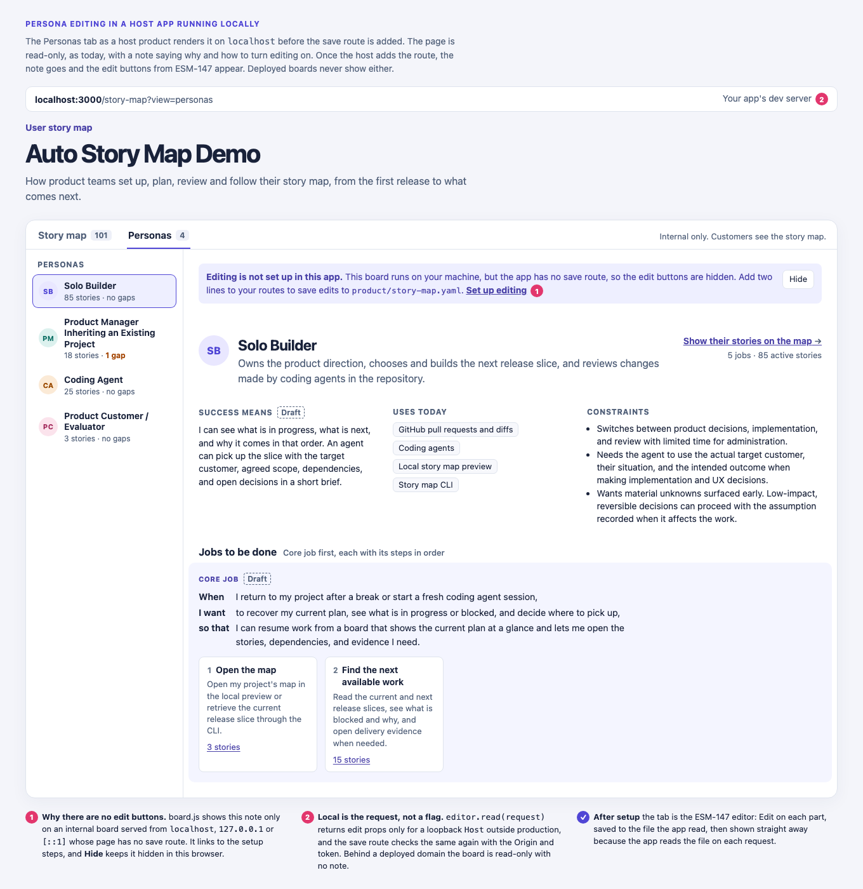

# Plan: turn on persona editing in a host app running locally

Status: shipped. The work is ESM-156 in the **0.7.6: Triage, readiness and agent access** release of the map. Its estimate is agreed: 5 points.

A solo builder runs their own product on their machine, opens its board, and wants to reword a persona the way they can on `story-map preview`. ESM-147 built the editor and made it work on the preview and the example host, but testing it in a vinext (Next-compatible) host found that a host's own board needs more set-up than the guide says, and in five ways the documented path does not work:

1. **"Local" is ambiguous.** The guide says editing is on wherever the board runs on your machine, but a host's board has no edit buttons until the host wires up a save route, and nothing on the page says why.
2. **Bundled maps go stale.** Many hosts import the YAML at build time, such as `story-map.yaml?raw`. A save writes the file, but the page keeps the old map until a rebuild, and `editing(source)` hashes the old text, so the next save is refused as stale.
3. **Node-only handler.** `handle()` takes Node's request and response. App Router, vinext, Remix, Hono and Workers routes get a Fetch `Request`, so each host writes its own wrapper.
4. **Who may edit is unstated.** The token proves the page came from this server, not that the person may edit. A route mounted without the board's own `canViewInternal` check lets any signed-in user of the local app edit the map.
5. **No safe way to know "this is local".** The snippet does not say how to keep editing off in production, so each host invents a check.

It builds on **ESM-147**, [Edit personas in place on the local preview](edit-personas.md#change), merged, and changes none of its editing. It overlaps **ESM-112**, [Save changes from the local preview](local-triage.md#3-save-changes-from-the-local-preview), planned, which will add status and release edits to the same handler, so they reach host boards through this work too. It also overlaps **ESM-154**, [Add and delete jobs on the local Personas tab](add-delete-jobs.md#change), and **ESM-155**, [Add a persona on the local Personas tab](add-persona.md#change), both merged, whose `create-job`, `delete-job` and `create-persona` edits go through the same handler and so reach host boards once this lands. **ESM-404**, editing on a deployed board, stays cut.

## Why the server writes the file

The app already knows the file: its server read `product/story-map.yaml` to render the board. The browser does not. It only gets the rendered page, and a web page cannot write to a path on disk, by design. So a save has to go back to the server that read the file, and the host needs one route for it. This plan makes that route a single line, and makes everything else automatic.

## UI mockup



The mockup is [host-persona-editing-mockup.html](host-persona-editing-mockup.html), built on the real `styles.css` with the Personas tab markup for this repository's map. To refresh the image, open it in a browser at 1360 px wide and take a full-page screenshot. ESM-156 links to this section from its `sources`.

What it shows:

1. **A note when editing is not set up.** On an internal board served from `localhost`, `127.0.0.1` or `[::1]` whose page has no `personaEditing`, board.js shows a note at the top of the Personas tab: editing is not set up in this app, with a link to the steps. **Hide** keeps it hidden in this browser. Deployed boards and customer views never show it.
2. **Local comes from the request.** The host does not set a flag. Edit props come back only when the request's `Host` is a loopback address and the app is not running in production.
3. **After set-up**, the note goes and the tab is the ESM-147 editor, saving to the file the app read and showing the change straight away.

## Change

In `src/edit-server.ts`:

- **`editor.read(request?)`** reads the map file from disk and returns `{ source, document, editing }`: the text, the parsed document for `getStoryMapPage`, and the props for `StoryMapBoard`'s `personaEditing`. `editing` is `undefined` unless editing is on for this request (below), so the host passes it through without its own check. Reading on each request means a save shows on the next load, and the revision always matches the file. This fixes problem 2: a host that bundles the map switches to `read()` for its board route.
- **`editor.handleRequest(request: Request): Promise<Response>`** answers a Fetch request with the same checks as `handle()`: loopback `Host`, matching `Origin`, JSON, the token, the revision, the size limit and persona operations only. `handle()` stays for Node servers and becomes a thin wrapper over the same code. This fixes problem 3.
- **`authorize`**, a required option, `(request) => boolean | Promise<boolean>`. `read()` returns no `editing` and the handler answers 403 unless it returns `true`. The docs show it calling the same `canViewInternal` rule as the board. Making it required means a host cannot mount the route without deciding who may edit. This fixes problem 4.
- **When editing is on.** Both `read()` and the handler require a loopback `Host`, as the handler already does, and `enabled`, an option that defaults to `process.env.NODE_ENV !== "production"`. A deployed app is served under its own domain and built for production, so both checks fail there, and the browser's `Origin` would not match either. A host can pass `enabled: false` to turn editing off, or its own rule. No environment variable to set or remember. This fixes problem 5.

The host's set-up becomes:

```ts
import { createStoryMapEditServer, getStoryMapPage, parseStoryMap } from "auto-story-map";

const editor = createStoryMapEditServer({
  map: "product/story-map.yaml",
  authorize: async request => canViewInternal(await viewerFrom(request)),
});

// The board's route: read the file on each request instead of importing it.
const { document, editing } = await editor.read(request);
const map = getStoryMapPage(document, viewer, { canViewInternal, searchParams: url.searchParams });
// <StoryMapBoard map={map} personaEditing={editing} />

// The save route, at storyMapEditPath:
export const POST = (request: Request) => editor.handleRequest(request);
```

In the board:

- **Set-up note** (`src/board.ts`, `styles.css`): on an internal Personas tab with no edit endpoint, board.js checks `location.hostname`. For a loopback host it adds the note from the mockup, linking to the guide section. It is added by board.js, not rendered on the server, so a deployed page's HTML never mentions editing. The server marks the internal Personas page so board.js knows it is internal. This fixes problem 1.

The example host switches to `read()` and `handleRequest`'s Node wrapper, so it shows the recommended shape.

## Set-up by the agent

The [first-run workflow](../story-map.md#populate-the-first-map) gets a step: when the host renders the board, add the save route and switch its board route to `editor.read()`, using the host's existing internal-viewer rule for `authorize`. A solo builder who sets up Auto Story Map with an agent then gets editing without doing it by hand. The [upgrade steps](../story-map.md#upgrade-to-070) say the same for hosts that already use the library.

## Docs

Rename **Edit personas on the local preview** to **Edit personas on your machine**, and split it:

- **On the preview**: works with no set-up, as now.
- **In your own app**: needs the route above. Say plainly that a host board is read-only until it is added, that the board must read the file on each request, that `authorize` must match the board's internal check, and that editing turns itself off in production and on any non-loopback `Host`.

## Tests

Name each `ESM-156: …`.

- `read()` returns the file's current text and a matching revision after a save, so a second save is accepted.
- `read()` returns no `editing` for a non-loopback `Host`, with `enabled: false`, when `NODE_ENV` is `production`, and when `authorize` returns `false`.
- `handleRequest` gives the same status and body as `handle()` for each refusal and for a successful save.
- `createStoryMapEditServer` without `authorize` throws, with a message saying what to pass.
- The board renders no set-up note on the server, and marks the internal Personas page for board.js.

## Estimate

5 points, agreed.

## Questions for review

- **Required `authorize`.** Required is safer, but it breaks a host that already mounts the ESM-147 handler. 0.7.6 is not released yet, so now is the time. Alternatively default it to refusing, with a warning in the log.
- **Release.** Placed in 0.7.6 beside ESM-147. It could be 0.7.7 if 0.7.6 should close.
