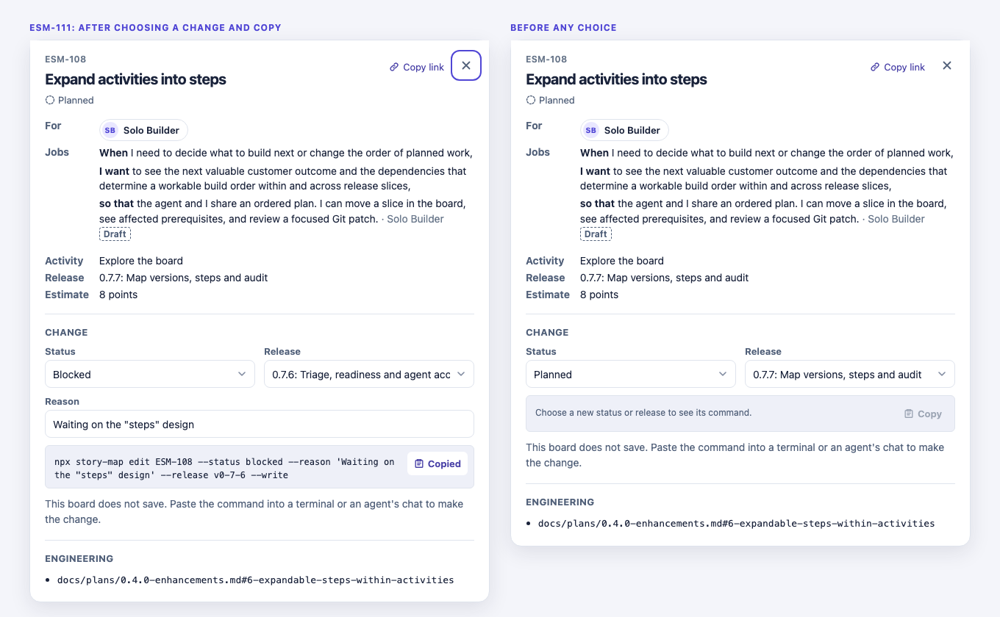
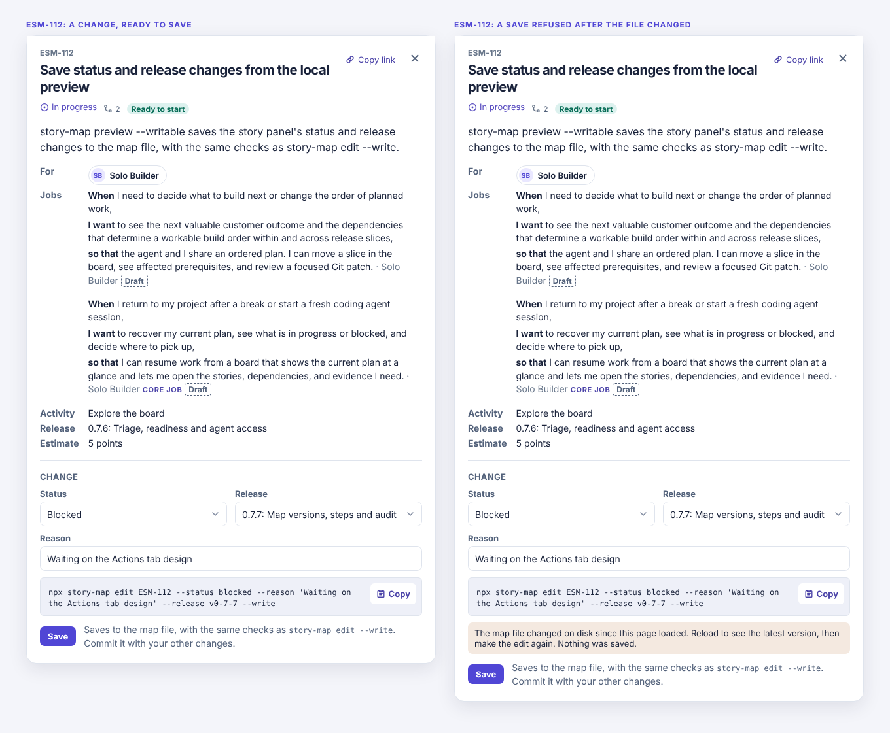

# Plan: confirm drafts and triage from the local preview

Status: proposed. The work is ESM-110, ESM-111 and ESM-112 in the **0.7.6: Triage, readiness and agent access** release of the map. The estimates below are agreed.

A person working alone, or a small team, spends most of their time with the map doing two things: confirming what an agent drafted, and moving stories between releases or statuses while looking at the board. Today both mean editing the YAML or asking an agent. This plan makes both quicker without giving agents a way to confirm drafts and without making the hosted board writable.

Items are numbered in the order they should be built:

1. [Confirm drafts from the command line](#1-confirm-drafts-from-the-command-line) (ESM-110)
2. [Change status and release from the story panel](#2-change-status-and-release-from-the-story-panel) (ESM-111)
3. [Save changes from the local preview](#3-save-changes-from-the-local-preview) (ESM-112)

The plan comes from a review of outside suggestions. Two of them are not planned, for the reasons in [Not planned](#not-planned).

## 1. Confirm drafts from the command line

`story-map confirm <ID>` removes `draft: true` from a job, a persona's context, or a release's impact item, so a person who has reviewed an agent's draft does not have to find the line in the YAML.

- **IDs:** a job ID, a persona ID for its context, or `<release ID> --impact <n>` for an impact item. `--all-in <persona ID>` confirms every draft job of one persona.
- **Dry run first**, like `story-map edit`: it prints each draft as the reader sees it, such as the job's “When …, I want …, so that …” statement, then the line diff. `--write` saves.
- **People only.** Agents must not remove `draft` (ESM-744). `--write` asks the person to type the ID back on an interactive terminal, and refuses when standard input is not a terminal, which is how agents run commands. There is no flag to skip the prompt. `AGENTS.md` and the guide say agents never run it with `--write`. This does not stop a determined agent, but it keeps the ordinary path for agents a dry run.
- **Credit:** the history already credits the commit author, and `diff` already reports confirmed drafts under “Confirmed”, so neither changes.

Builds on `proposeStoryMapEdit` in `src/edit.ts`, which keeps comments and untouched lines. Estimate: 3 points.

## 2. Change status and release from the story panel

The internal story panel gets a **Change** section with a status picker, a reason field for blocked and cut, and a release picker. On a read-only board, the hosted one and the default preview, it does not save: it shows the matching command, such as `npx story-map edit ESM-108 --release v0-7-5 --write`, with a **Copy** button, to paste into a terminal or an agent's chat.

- Internal view only. The customer view does not change.
- The command is built from the same options `story-map edit` takes, with each value quoted for the shell, so a reason with quotes or spaces pastes safely. A test checks the quoting against `story-map edit`'s parser.
- No backend and no new rights: copying a command changes nothing.

It uses the story permalinks from ESM-122, in 0.7.4. This is the UI that item 3 saves from, so it is built first and item 3 adds only the save. Estimate: 3 points.

### UI mockup

The mockup is [change-command-mockup.html](change-command-mockup.html), generated from the built board and the real `styles.css` with this product's map, with the **Change** section in the state `board.js` leaves it. To refresh it, render the panel again and take a screenshot at 1360 px wide. ESM-111 links to this section from its `sources`.

## 3. Save changes from the local preview

`story-map preview` lets the **Change** section from item 2 save straight to the map file, through the same checks as `story-map edit --write`.

- **Already there:** ESM-147 made the preview writable by default (`--read-only` turns it off) and added the endpoint, in `createStoryMapEditServer`, and the security and stale-page checks below, for persona edits. This item adds the status, reason and release operations to it and the save to the **Change** section.
- **Endpoint:** the preview accepts one `POST /api/story-map/edit` with a list of edit operations, unless it runs with `--read-only`. It runs `proposeStoryMapEdit` and writes the file only when the result is valid, then the board reloads. Operations are limited to status, reason and release, so the panel cannot do what `edit` refuses, such as removing `draft`.
- **Security:** the preview already refuses other `Host` headers, which stops DNS rebinding, but a page on another site can still post a form to `127.0.0.1`. So the endpoint also needs an `Origin` header that matches the preview, a JSON content type, and a random token generated at start-up and put in the page. The server still listens on the loopback address only.
- **Stale page:** each request carries a hash of the file the page was rendered from. If the file has changed on disk since, the save is refused and the page asks the person to reload, so an agent's edit or a `git pull` is not overwritten.
- **Credit:** nothing new. The change is a normal file edit, so the commit that includes it credits its author.
- **Not drag and drop, yet.** Dragging cards between release lanes needs keyboard and screen reader support and a new drag layer on the board. The pickers in item 2 cover the same moves. Dragging can follow as its own story if people ask for it.

ESM-404 stays cut: the hosted board stays read-only, because saving there would need the map on a hosted service. This item writes only to a file on the person's own machine. Estimate: 5 points.

### UI mockup for saving

The mockup is [save-change-mockup.html](save-change-mockup.html), generated from the built board and the real `styles.css` with this product's map, rendered with `storyEditing` as `story-map preview` renders it, and the **Change** section in the state `board.js` leaves it. To refresh it, render the panel again and take a screenshot at 1360 px wide. ESM-112 links to this section from its `sources`.

## Not planned

**A `lean` validation mode.** The suggestion was to quiet warnings that small teams find noisy: chore stories that serve no job, and missing customer copy. Neither warning exists today. Validate warns about untagged stories only when more than half of the active stories say nothing about who they are for, and it never asks for customer copy, which stays optional and internal by default. Warnings already leave CI green unless `--strict` is set (ESM-401). A mode that switches nothing off would add a setting to explain and no benefit. If a real warning turns out to be noisy for small maps, fix that warning.

**Job statements as sentences in PR summaries.** Already built: `story-map diff` prints each added or reworded job as “When …, I want …, so that …”, and lists confirmed drafts (ESM-304, ESM-901).

## Effort and release fit

| Story | Points |
| --- | --- |
| ESM-110: Confirm drafts from the command line | 3 |
| ESM-111: Show the edit command in the story panel | 3 |
| ESM-112: Save status and release changes from the local preview | 5 |
| **Total** | **11** |

0.7.6 first also held activity steps (ESM-108), the scheduled audit (ESM-109) and map versions (ESM-113 to ESM-115). When it was split, those moved to 0.8.2, and these stories stayed in 0.7.6 with the Actions tab (ESM-128) that points to them.
