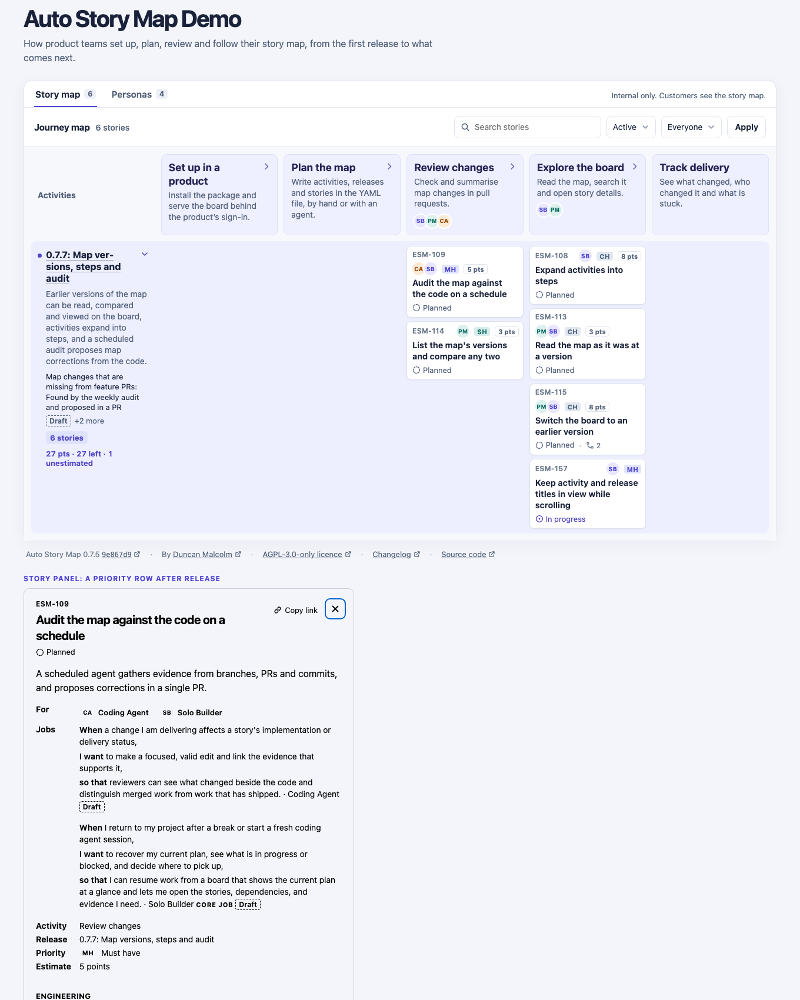

# Plan: MoSCoW priority on stories

Status: built. The work is ESM-158 in the **0.7.6: Triage, readiness and agent access** release of the map. It builds on ESM-503, which added estimates, and follows the same pattern: an optional internal field, shown on the card and in the story panel.

Each story can carry a MoSCoW priority, so the team can see at a glance which planned work is a must, should or could have.

## UI mockup

The mockup is [moscow-priority-mockup.html](moscow-priority-mockup.html), built on the real `styles.css` and the board's real markup, rendered from this product's map with the 0.7.7 lane kept. The panel below the board is a copy of ESM-109's story panel. To refresh the image, serve the repository root, open the file at 1360 px wide and take a full-page screenshot. ESM-158 links to this section from its `sources`.

What it shows:

1. **Card tag** on the ID line, after the persona avatars and before the estimate: **MH** in the indigo of the first lane, **SH** in teal, **CH** in grey, so must reads strongest. Screen readers hear “Priority: Must have”.
2. **Narrow cards** wrap the avatars and tags under the ID, instead of squeezing the ID onto several lines.
3. **Story panel**: a **Priority** row after **Release**, with the tag and its full name.

The tag reuses the lane chip and ink colours, so the light, dark and system palettes need no new properties.

## Decisions

| Question | Choice |
| --- | --- |
| A. The field | An optional `priority` on each story: `must`, `should` or `could`. Any other value is a validation error. |
| B. Won't have | Left out. A story the team will not do is `cut`, with a `statusReason`. |
| C. Who sees it | Internal viewers only. The customer projection is an allow-list, so it drops the field, and a test proves it. |
| D. Setting it | `story-map edit <ID> --priority must|should|could|none`, and the `priority` op in `--from` files and `propose_edit`. |
| E. Agents | A priority is the team's call. An agent may suggest one in a PR, and says so. |

## Not in this round

- Filtering the board or `story-map stories` by priority.
- Priority in the CSV, Visio and brief exports.
- Validation warnings for planned stories with no priority.
