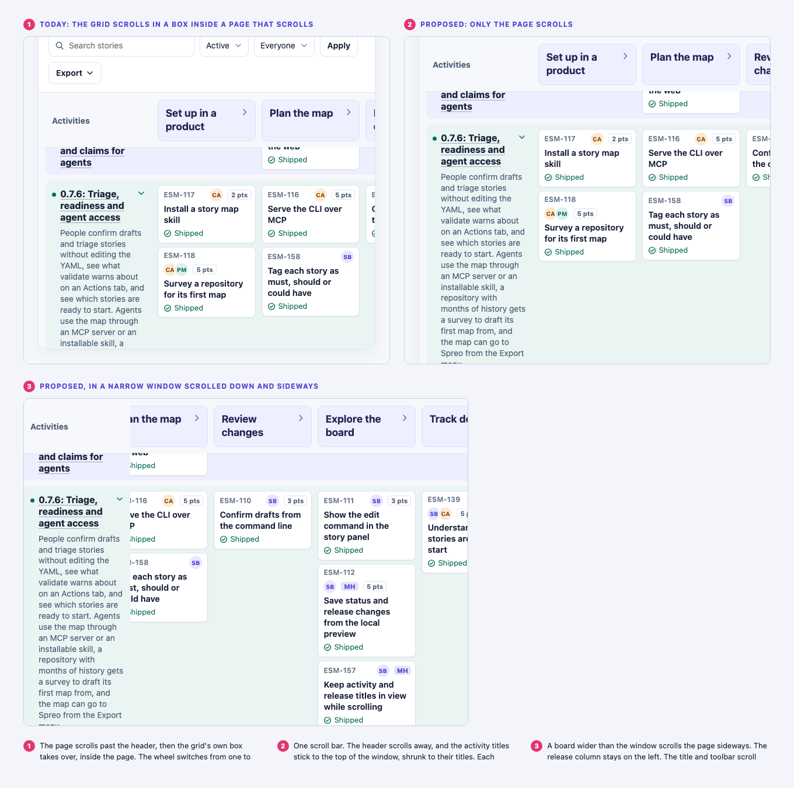

# Plan: scroll the board with the page, not in a box of its own

Status: merged. The work is ESM-192 in the **0.7.11: Code review and architecture checks** release of the map. It has no agreed estimate yet.

Since ESM-157, the grid scrolls in its own box, no taller than the window, so that its headings can stick. The box sits under the board's header, tabs and toolbar, so the page scrolls too. In a 768 px window the box starts 363 px down a page 1,081 px tall: the page scrolls by about 313 px and the grid by 14,300 px inside it. Readers get two vertical scroll bars, one inside the other, and the mouse wheel switches from one to the other part-way down.

It builds on **ESM-157**, [Keep activity and release titles in view while scrolling](sticky-board-headings.md), shipped, whose sticky headings must keep working, and on **ESM-412**, [Collapse release lanes](../ENGINEERING-OVERVIEW.md#layout), and **ESM-122**, permalinks, both shipped. ESM-157's plan weighed this option and chose the box, because a wide board makes the page scroll sideways. After trying both in the preview, the repository owner chose page scrolling.

It overlaps two planned stories, and neither has to land first:

- **ESM-108**, [Expand activities into steps](0.4.0-enhancements.md#6-expandable-steps-within-activities), changes the heading row, which now sticks to the window rather than to a box.
- **ESM-134**, [Summarise delivery on each release lane](delivery-metrics.md#5-summarise-delivery-on-each-release-lane), adds content to the release column, which sticks to the left of the window.

## Options tried

Both were built behind a switch in the preview and tried in Chrome.

| Option | Result |
| --- | --- |
| **Only the page scrolls** (chosen) | One scroll bar each way. The headings stick to the window. A board wider than the window scrolls the page sideways, and the title and toolbar scroll away with it. |
| Fit the grid's box to the window | The page stops scrolling and only the grid moves, but the header and toolbar stay on screen: in a 768 px window the grid gets 335 px. |

## UI mockup

The mockup is [page-scroll-board-mockup.html](page-scroll-board-mockup.html), built on this branch's `styles.css` with the board rendered from this repository's map. Each window stands in for a browser window, and the scrolling works, so open it in a browser and try it. To refresh the image, take a screenshot at 1360 by 1350 px.

What it shows:

1. **Today.** The page scrolls past the header, then the grid's box takes over.
2. **Proposed.** One scroll bar. The header scrolls away, the activity row sticks to the top of the window and shrinks to its titles, and each release name stays beside its lane.
3. **Proposed, narrow.** The page scrolls sideways and the release column stays on the left.

## Change

In `styles.css`, for windows wider than 650 px and taller than 480 px:

- `.esm-scroll` keeps `position: relative` and `isolation: isolate`, and gets `overflow: visible`. With no scroll box of its own, `position: sticky` on the headings sticks to the window.
- The `.esm-frame` around the map gets `min-width: min-content`, so it grows to the grid's width and a wide grid scrolls the page. The Actions tab's table keeps its own sideways scroll.
- Lanes and the cards in each cell get `scroll-margin` from `--esm-activities-height` and `--esm-labels-width`, in place of the box's `scroll-padding`, so permalink targets and focused cards stop clear of the headings.
- `.esm-scroll[data-esm-scroll-box]` gets the box from ESM-157: `max-height: var(--esm-board-height)`, `overflow: auto` and its `scroll-padding`. `--esm-board-height` loses its default.

In `src/board.ts`, `enhanceStoryMapHeadings`:

- Reads `--esm-board-height`. When a host sets it to a length, it sets `data-esm-scroll-box`, follows the box's scroll and brings the grid into view after a permalink, as today.
- Otherwise it follows the page's scroll, and shrinks the row once the grid's top has scrolled above the window by the height that saves.

Without JavaScript the page still scrolls, and the activities and release column still stick. Small windows and print are unchanged. Customer boards get the same behaviour, and exports and the Personas tab do not change.

## Architecture decisions

Following [Record architecture decisions](../ENGINEERING-OVERVIEW.md#record-architecture-decisions).

- **Where it runs.** In the viewer's browser, in the existing `styles.css` and `board.js`. No new service, data store or export.
- **Data and contracts.** Upstream, nothing new: the board's markup does not change. Downstream, hosts that import `styles.css` get a board that scrolls with their page. `--esm-board-height` is documented for hosts, and its meaning changes: left out, the grid no longer has a box, and set to a length, it gets one only once `board.js` has run.
- **Boundaries.** None of the [security boundaries](../ENGINEERING-OVERVIEW.md#security-boundaries-to-preserve). The layout depends on the host page: a parent of the board with `overflow` other than `visible` becomes the box the headings stick to.
- **Reversibility.** Easy: the change is a few CSS rules and one branch in `board.js`, and reverting them restores the box.

Consequential decision: changing the default of `--esm-board-height`, a documented styling contract. Consumers: every host that imports `styles.css`, whose page now scrolls the board, and hosts that set the variable, which keep the box only with `board.js`. Alternatives considered: fitting the box to the window, in [Options tried](#options-tried), and a new `scroll` prop on `StoryMapBoard`, which would let hosts choose without `board.js` but adds an API. Agreed by: the repository owner chose page scrolling in the session on 28 November 2026, after trying both options. Keeping the box only through `board.js` is a **proposal** for them to confirm. Revisit if a host needs the box without `board.js`, or if hosts with a fixed header ask for the headings to stick below it.

## Docs

Update the board section of `docs/story-map.md`, where hosts read about `--esm-board-height`, and [Layout](../ENGINEERING-OVERVIEW.md#layout) in the engineering overview. The changelog entry tells hosts that the board now scrolls with the page, and how to keep the box.

## Tests

Name each `ESM-192: …`.

- `styles.css` gives `.esm-scroll` no scroll box of its own, widens the frame around the map, keeps targets clear of the headings, and gives a box only with `data-esm-scroll-box`, with no default height.
- `enhanceStoryMapHeadings` follows the page's scroll when `--esm-board-height` is left out or `none`, and the box's scroll, with `data-esm-scroll-box`, when it is a length.

ESM-157's tests keep checking that the headings stick and the row shrinks.

The tests do not run a browser, so check by hand in Chrome, Firefox and Safari: one scroll bar at full width and in a 900 px window, the headings sticking both ways, a permalink to a story far down, the Actions tab's table, collapsed lanes, and a host that sets `--esm-board-height`.

## Estimate

Not agreed yet.

## Questions for review

- **Box without `board.js`.** Is it acceptable that hosts that set `--esm-board-height` keep the box only with `board.js`? The alternative is a prop on `StoryMapBoard`.
- **Fixed host headers.** The activity row sticks to the very top of the window, so a host's own fixed header would cover it. Those hosts can keep the box with `--esm-board-height`. Should the board also take a top offset, such as `--esm-sticky-top`?
- **Release.** Placed in 0.7.11, the release collecting current work.
