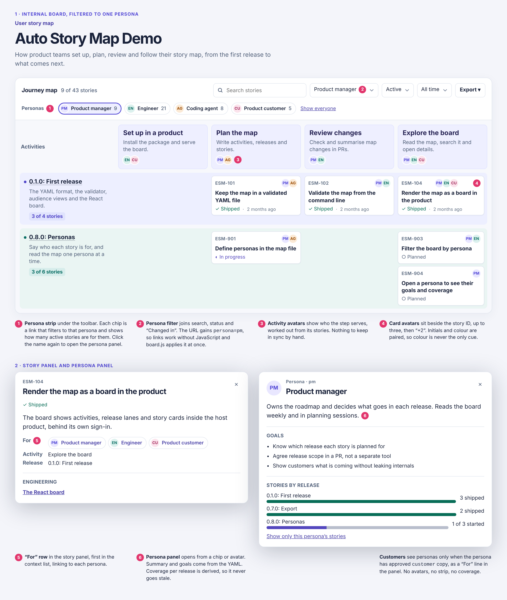

# Plan: personas on the story map

Status: proposed. The stories are ESM-901 to ESM-906, in the **Next** release of the map until a release is agreed (see [decision G](#decisions-to-make)).

A story map answers “what do we build, in what order”. It does not yet say **who each story is for**. Personas add that: the map file names the people the product serves, each story says which of them it helps, and the board lets viewers read the map one persona at a time.

Items are numbered in the order they should be built, and each section uses the same number:

1. [Define personas in the map file](#1-define-personas-in-the-map-file) · ESM-901
2. [Show who a story is for](#2-show-who-a-story-is-for) · ESM-902
3. [Filter the board by persona](#3-filter-the-board-by-persona) · ESM-903
4. [Open a persona to see goals and coverage](#4-open-a-persona-to-see-goals-and-coverage) · ESM-904
5. [Share approved personas with customers](#5-share-approved-personas-with-customers) · ESM-905
6. [Include personas in exports](#6-include-personas-in-exports) · ESM-906

All stories are internal. Item 5 changes what customers can see, but only for personas whose customer copy has been approved, as for stories today.

## UI mockup



The mockup is [personas-mockup.html](personas-mockup.html), built on the real `styles.css`. To refresh the image, open it in a browser at 1360 px wide and take a full-page screenshot. The cards are real stories with illustrative persona tags.

What it shows:

1. **Persona strip** under the toolbar. One chip per persona, with initials, a colour and the number of active stories for them. A chip is a link to `?persona=<id>`, so it works without JavaScript.
2. **Persona filter** in the toolbar, next to status and “Changed in”. The chip strip and the select set the same parameter.
3. **Activity avatars**: who each step of the journey serves, derived from the stories under it.
4. **Card avatars** beside the story ID: up to three, then “+N”.
5. **“For” row** in the story panel, first in the context list.
6. **Persona panel**: summary and goals from the YAML, and coverage per release worked out from the stories.

When a persona is chosen, releases with no matching stories are hidden, as the other filters do now. A rejected alternative was to dim non-matching cards instead of hiding them. It keeps the shape of the map, but on large maps the persona's stories are hard to find among the dimmed ones. It could come back as a “Highlight” option later.

## The format

```yaml
personas:
  - id: pm
    title: Product manager
    summary: Owns the roadmap and decides what goes in each release.
    goals:
      - Know which release each story is planned for
      - Agree release scope in a PR, not a separate tool
    customer:            # optional, approved wording only
      title: Product teams
stories:
  - id: ESM-104
    title: Render the map as a board in the product
    activity: explore
    release: v0-1
    personas: [pm, engineer, customer]
```

- `personas` on the map is optional, up to 12 entries. Each has the usual `id`, `title`, `summary` and `customer`, plus optional `goals` (up to 5, each up to 200 characters).
- `personas` on a story is optional: a list of persona IDs, up to 4, in order of importance. The first is the primary persona.
- Initials come from the title (“Product manager” → PM), and the colour from the persona's position in the list, so neither is stored. A six-colour palette is enough for 12 personas, because initials and colour together tell them apart.
- Activities and releases get no `personas` field. Activity avatars are derived, so there is nothing to keep in sync.

## Decisions to make

| Question | Recommendation | Alternatives |
| --- | --- | --- |
| A. Where personas live | In `story-map.yaml`, next to activities and releases | A separate `personas.yaml`. Rejected: one file is the source of truth, and validation would need two |
| B. Can a story have several personas | Yes, up to 4, first is primary | One persona per story. Simpler, but forces a choice for shared stories such as search |
| C. Untagged stories | Allowed. The filter has no “Untagged” option at first, and validate warns only when the map has personas and more than half of the active stories are untagged | Make `personas` required once the map defines any. Too strict for existing maps |
| D. What a persona filter keeps | Stories tagged with any chosen persona. Several personas can be chosen, like statuses | Primary persona only |
| E. Persona fields | `id`, `title`, `summary`, `goals`, `customer` | Add `pains`, `quote` or an image. Keep it small until teams ask; images also raise hosting and privacy questions |
| F. Customer view | Show approved personas as a “For” line in the story panel only | No personas for customers at all. Also fine; item 5 can be dropped without affecting the rest |
| G. Release | A new **0.8.0: Personas** release, after the export work | Keep in **Next** |

### Assumptions to confirm

- **Search matches persona titles** for internal viewers, so searching “agent” finds stories for the Coding agent persona.
- **Persona counts on chips** count active stories only, like the release counts, and ignore the other filters so the numbers do not jump as you filter.
- **Removing a persona** that stories still use is an error, like removing an activity. Renaming one keeps its ID.
- **No change to the status history**. A persona change counts as an edit to the story for “last updated”, because the history already compares whole stories.

## Suggested order

| Item | Name | Size | Depends on |
| --- | --- | --- | --- |
| 1 | Define personas in the map file | M | — |
| 2 | Show who a story is for | M | 1 |
| 3 | Filter the board by persona | S | 2 |
| 4 | Open a persona to see goals and coverage | S | 2 |
| 6 | Include personas in exports | S | 1 |
| 5 | Share approved personas with customers | S | 2 |

Items 1 and 2 can share a PR if the first is small. Every PR follows the repository's rules: update `product/story-map.yaml` in the same PR, run `npm run validate` and `npm test`, add a `## Unreleased` entry to `CHANGELOG.md`, and include the `story-map diff origin/main` summary in the PR description. Tag new tests with the story ID, such as `test("ESM-901: rejects an unknown persona", …)`.

---

## 1. Define personas in the map file

**Change.**

- `src/schema.ts`: add the `persona` object and the optional `personas` list to the map, and `personas` to the story. The lenient schema drops them for older maps, as it does for other fields.
- Cross-reference checks: duplicate persona IDs, unknown persona IDs on a story, the same persona twice on a story, and a customer-facing persona used on a story that has no customer copy (allowed, but the persona is not shown).
- Warnings: a persona no story uses, and the untagged-stories rule from decision C.
- `story-map.schema.json` is rebuilt, so editors complete persona IDs.
- `src/diff.ts`: report added, removed and renamed personas, and persona changes on stories, such as “ESM-104: for Product manager (was Engineer)”. Customer-facing persona copy is called out like other customer copy.
- `src/init.ts` and `templates/`: the starter map gets one example persona.
- Dogfood: add personas to this repository's map (Product manager, Engineer, Coding agent, Product customer) and tag existing stories.

**Docs.** A **Personas** section in `docs/story-map.md`, a row in [Where an edit belongs](../story-map.md#where-an-edit-belongs), and a step in the [first-run workflow](../story-map.md#populate-the-first-map): the agent drafts personas from the host product's roles, sign-in roles and docs, keeps them internal, and asks a person to confirm them. `AGENTS.md` gets one sentence: tag new stories with existing persona IDs, and never invent a persona without saying so in the PR.

**Tests.** Valid and invalid persona maps, the warnings, the diff lines, and a property test that every persona reference survives `parseStoryMap` round trips.

## 2. Show who a story is for

**Change.**

- `src/view.ts`: the internal view gains `personas: PersonaLabel[]` (id, title, summary, goals, initials, colour index) and each story card gains `personas: string[]`.
- `src/react.tsx`:
  - `PersonaAvatar` and `PersonaAvatars` components, with the persona title as accessible text (“For Product manager and Coding agent”), so screen readers do not read initials.
  - Card avatars in a new `esm-card-head` row beside the ID.
  - Activity avatars from the union of the personas of the activity's active stories.
  - A **For** row first in the story panel's context list.
- `styles.css`: `--esm-persona-0` to `--esm-persona-5` with matching backgrounds, in light, dark and auto themes. Check each pair for 4.5:1 contrast.
- Narrow screens: avatars stay on cards; activity avatars are hidden with the activity row, as now.

**Tests.** Rendering with and without personas, accessible names, the “+N” overflow, and that a map without personas renders exactly as before.

## 3. Filter the board by persona

**Change.**

- `src/filter.ts`: `StoryMapFilters.persona?: readonly string[]`, read from a repeated `persona` parameter. Unknown IDs are ignored. `filter.persona` is set on the view when it narrows anything.
- Search also matches persona titles (internal only).
- `src/react.tsx`: the persona strip under the toolbar and a persona menu in the toolbar, built like the status menu (`<details>` with checkboxes). The strip is hidden when the map has no personas.
- `src/board.js`: apply persona changes as they happen, like the other filters.
- Persona chips keep the other parameters, through `preservedParams`, like the other filter links.

**Tests.** URL reading, combined filters, a persona with no stories, and that customers' persona parameters only match customer-facing personas.

## 4. Open a persona to see goals and coverage

**Change.** A `PersonaDetail` popover, opened from a chip, an avatar or the story panel's **For** row, using the same popover pattern as `ReleaseDetail`. It shows the summary, goals and one row per release with that persona's stories by status, and a link that applies the persona filter. Coverage uses the unfiltered view so it does not change with filters.

**Tests.** Counts per release, releases with no stories for the persona are left out, and the panel works without JavaScript.

## 5. Share approved personas with customers

**Change.** The customer projection keeps only personas with `customer` copy that at least one published story uses, renumbered like activities (`persona-1`, …) so internal IDs never leak. Customer cards show no avatars; the story panel shows a **For** line with the customer titles. The persona filter is offered to customers only when two or more personas are visible.

**Tests.** Internal-only personas never appear in the customer view or its JSON, IDs are replaced, and a story tagged only with internal personas shows no **For** line.

## 6. Include personas in exports

**Change.**

- CSV: a `Personas` column with persona titles joined by “; ”.
- JSON for agents: the map's `personas` and each story's `personas`, so an agent can spot journeys with no stories for a persona.
- Visio: a `Personas` field in each card's shape data, so Lucidchart can filter by it. No avatars on the exported cards for now.

**Tests.** Each export with and without personas; CSV escaping of persona titles.

## Later

- **Persona swimlanes**: an option to group rows by persona instead of release, for discovery workshops.
- **Gaps**: flag activities where a persona has no planned stories, for the scheduled map audit.
- **Highlight mode**: dim rather than hide stories for other personas.
