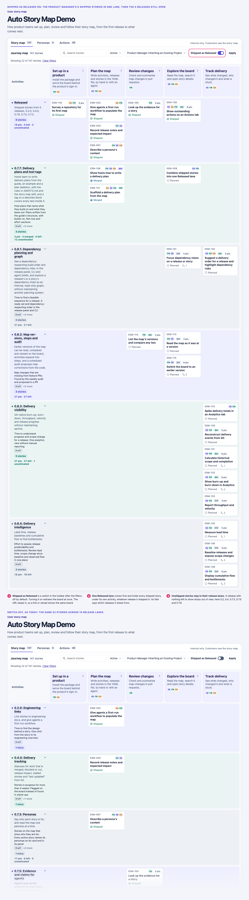

# Plan: Combine shipped stories into one Released lane

Status: merged. The work is ESM-208 in the **0.7.7: Delivery plans and test tags** release of the map. It has no agreed estimate yet.

The board puts every story in the lane of the release it belongs to. Once a product has shipped a few releases, most of the board is old release lanes. Filtered to one persona, the stories that persona already has are spread across lane after lane, between the ones still to come. On this repository's map, the Product Manager Inheriting an Existing Project has 22 stories across 10 release lanes, and the 6 that have shipped are in 5 of them.

Items are numbered in the order they should be built:

1. [Combine shipped stories into one Released lane](#1-combine-shipped-stories-into-one-released-lane) (ESM-208)

## What it builds on

Shipped:

- **ESM-412**, [Collapse release lanes](../ENGINEERING-OVERVIEW.md#layout): the lane header, collapse toggle and remembered collapsed lanes. The Released lane gets the same header and toggle. Collapsing hides one lane at a time and keeps every lane header, so it does not solve this on its own.
- **ESM-903**, [Filter the board by persona](personas.md#3-filter-the-board-by-persona): the persona menu this switch sits beside, and the filter the main use combines it with.
- **ESM-414**, [Choose several statuses in the filter](../story-map.md#blocked-and-cut-stories): the status filter. Unticking Shipped leaves the Released lane empty, so it drops out of view like any empty lane.
- **ESM-157**, [Keep activity and release titles in view while scrolling](sticky-board-headings.md): the sticky release heading, which the Released lane uses as it is.
- **ESM-192**, [Scroll the board with the page](page-scroll-board.md), merged: the grid now scrolls with the page, and the Released lane's heading sticks to the window like any release lane's.

Planned, and overlapping:

- **ESM-134**, [Summarise delivery on each release lane](delivery-metrics.md#5-summarise-delivery-on-each-release-lane), in 0.8.3, adds delivery figures under each release name. The Released lane is not a release, so it shows none. Whichever lands second makes sure the two agree.

## 1. Combine shipped stories into one Released lane

ESM-208. A **Shipped as Released** switch in the board's toolbar, off by default, moves every shipped story into one lane called **Released**, at the top of the board, under its own activity. Stories that are not yet shipped stay in their release lanes, and a release with nothing left to show drops out of view, as it does when a filter empties it.

The stories themselves do not change. Each card keeps its real release, which its panel shows, so permalinks, briefs, exports and the Actions tab are unaffected. The Released lane's header says how many shipped stories it holds and how many releases they come from, such as “Shipped stories from 5 releases.”, and it has no release panel, impact line or estimate. It collapses like any release lane.

The switch is a checkbox in the filter form with `role="switch"`, so screen readers announce it as on or off and it still submits with the form without JavaScript. With board.js, flipping it redraws the board at once, as choosing a select does. It is styled with the existing `--esm-*` colours, so the three palettes need no new properties, and it keeps a visible track in forced-colours mode.

It works with the other filters. The Product Manager's board in the mockup shows 6 lanes instead of 10. With Shipped unticked in the status filter, the Released lane is empty and not shown.

Done when:

- with the switch on, every shipped story that matches the filters is in the Released lane, under its activity, and every other story is in its release lane,
- the choice is in the URL, as `released=1`, so a link and a reload keep it, and links to the Personas and Actions tabs carry it,
- without JavaScript, turning the switch on and pressing Apply gives the same board.

## UI mockup

The mockup is [released-lane-mockup.html](released-lane-mockup.html), built on the real `styles.css` and the board's real markup, rendered from this repository's map with the persona filter set to the Product Manager Inheriting an Existing Project. For the first board, every shipped story was moved into one Released lane before rendering, as the switch would. The closed story and persona panels are left out to keep the file small. The **Shipped as Released** switch and its styles at the top of the file are proposed. To refresh the image, open it in a browser at 1360 px wide and take a full-page screenshot. ESM-208 links to this section from its `sources`.

What it shows:

1. **Shipped as Released** is a switch in the toolbar after the persona menu, off by default. It is on in the first board and off in the second.
2. **One Released lane** comes first, with ESM-118, ESM-202, ESM-105, ESM-403, ESM-907 and ESM-128 under their activities. Its summary names the five releases they shipped in. As built, it gives their number instead, because release titles in host maps have no short form to list.
3. **Unshipped stories stay where they are.** 0.7.7, 0.8.1, 0.8.2, 0.8.3 and 0.8.4 keep their lanes. 0.2, 0.4, 0.7.3, 0.7.5 and 0.7.6 drop out of view, because all their stories for this persona have shipped.

## Architecture decisions

- **Where it runs:** inside the existing board. `readStoryMapFilters` reads a new `released=1` parameter, and `StoryMapBoard` groups the shipped stories into the lane when it renders. board.js submits the form when the switch changes, and remembers nothing else: the URL holds the choice.
- **Data and contracts:** proposal. `view.filter` gains an optional `released: true`. It is part of the exported `StoryMapFilters` type, so hosts that read `view.filter` see a new optional field, and nothing they read today changes. The view's stories and releases are not changed, so the JSON view, exports, briefs and the CLI are unaffected. The lane's collapse value is `:released`, which no release ID can match because release IDs cannot hold a colon, and its anchor is `esm-released`, which no release lane's `esm-release-<ID>` can match. Alternative considered: moving the stories into a made-up release in `filterStoryMapView`, which would show the wrong release in story panels and briefs. Agreed by the repository owner on 2026-11-28, who asked for it to be built from this plan. Revisit if hosts need the Released lane in the JSON view or exports, which would mean a field on each story rather than a layout choice.
- **Boundaries:** none. It is a layout choice on the internal board. Customer boards do not get the switch, and it reads nothing a viewer could not already see.
- **Reversibility:** removing the parameter and the switch restores today's board. Old links with `released=1` would then show the board as today.

## Decisions to make

| Question | Proposal |
| --- | --- |
| A. Which stories go in the Released lane? | Shipped stories only. Merged stories are not yet available to their users, so they stay in their release. |
| B. Should the board remember the switch across visits, or only in the URL? | Only the URL, as built. Remembering it across visits would mean board.js reloading the page with the parameter, which flashes the board, so it waits until someone asks for it. |
| C. Should customer boards get it? | Not now. Customers see fewer releases, and the customer view's renumbered IDs would need their own lane ID. |
| D. Is 0.7.7 the right release? | Placed in 0.7.7 as asked. Every other 0.7.7 story is merged, so this story holds the release until it lands. |

## Not now

- Customer boards, as in decision C.
- Exports and the JSON view, which keep every story in its real release.
- Combining merged stories into a second lane, such as "Merged, not shipped".
- A Released lane on the Personas tab's job lanes.

## Effort and release fit

| Story | Points |
| --- | --- |
| ESM-208: Combine shipped stories into one Released lane | not agreed |
| **Total** | **not agreed** |

The story stands alone, so it can move to a later release without affecting any other.
