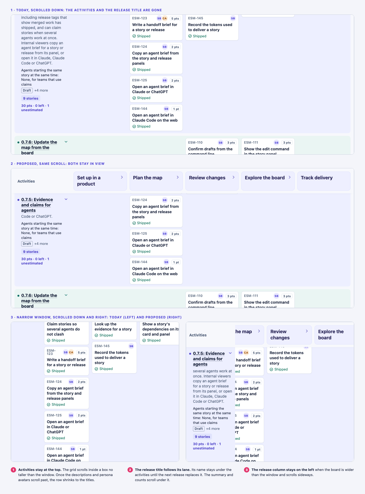

# Plan: keep activity and release titles in view while scrolling

Status: in progress. The work is ESM-157 in the **0.7.7: Map versions, steps and audit** release of the map. It has no agreed estimate yet.

On a map with several releases, scrolling down takes the activity titles off the top of the screen, and a tall release lane takes its own title with them. Scrolling sideways on a narrow window takes the release titles off the left. The reader is left with cards and no sign of which activity or release they belong to.

It builds on **ESM-104**, [Render the map as a board](../ENGINEERING-OVERVIEW.md#the-react-board), and **ESM-412**, [Collapse release lanes](../ENGINEERING-OVERVIEW.md#layout), both shipped, and must keep collapsed lanes to one line. Permalinks from **ESM-122**, shipped, must not land under the headings.

It overlaps two planned stories, and neither has to land first:

- **ESM-108**, [Expand activities into steps](0.4.0-enhancements.md#6-expandable-steps-within-activities), also in 0.7.7, changes the heading row. Whichever lands second must decide whether step headings stay in view too, and any toggle must stay reachable when the row shrinks.
- **ESM-134**, [Summarise delivery on each release lane](delivery-metrics.md#5-summarise-delivery-on-each-release-lane), adds content to the release column. It belongs below the pinned name, not in it.

## Why CSS alone on today's markup does not work

`.esm-scroll` has `overflow-x: auto` so a wide board scrolls sideways. Browsers then treat it as the scrolling box for both directions, so `position: sticky; top: 0` on the headings sticks to a box that never scrolls vertically, while the page does. Adding `sticky` to the headings has no effect.

| Option | Result |
| --- | --- |
| **Give the grid its own vertical scroll, no taller than the window** (recommended) | Sticky works in both directions, under any host header. The grid becomes a scroll area inside the page. |
| Remove the sideways scroll, so headings stick to the page | No inner scroll, but a wide board makes the whole host page scroll sideways. |
| Copy the headings into a fixed bar with JavaScript | No inner scroll, but duplicates headings for screen readers, must track sideways scroll, and needs JavaScript to work at all. |

## UI mockup

The mockup is [sticky-board-headings-mockup.html](sticky-board-headings-mockup.html), built on the real `styles.css` with the board rendered from this repository's map. The scrolling works, so open it in a browser and try it. To refresh the image, take a full-page screenshot at 1360 px wide.

What it shows:

1. **Activities stay at the top.** At full size the heading row takes about 180 to 200 px, over a third of a small window. Once the descriptions and persona avatars have scrolled past, it shrinks to the titles, about 93 px.
2. **The release name follows its lane.** The name and collapse toggle stay under the activities until the next release replaces them. The summary, impact and counts scroll under the name: pinning all of them pushed the name out of view on tall lanes.
3. **The release column stays on the left** when the board is wider than the window.

## Change

In `styles.css`, for windows wider than 650 px:

- `.esm-scroll` gets `max-height: var(--esm-board-height, calc(100dvh - 7.5rem))`, `overflow: auto`, `position: relative` and `isolation: isolate`, so the pinned parts never cover the toolbar menus. A board shorter than the window looks as it does today.
- `--esm-board-height` is a new documented variable. A host with a fixed header sets it, such as `calc(100dvh - 12rem)`. `none` restores today's page scrolling.
- `.esm-activities` sticks to the top, `.esm-corner` and `.esm-release` to the left, and `.esm-release-heading` under the activities. Each has an opaque background.
- `scroll-padding` keeps permalink targets and focused cards clear of the pinned parts (WCAG 2.4.11, Focus Not Obscured).
- Windows under 480 px tall, and print, keep today's page scrolling. The layout at 650 px and narrower does not change: it has no activity row or columns.

In `src/react.tsx`: wrap the collapse toggle and release name in `
`. The row and header roles do not change.

In `src/board.ts`, a new `enhanceStoryMapHeadings`, called with the other enhancements:

- Measures the heading row and release column with a `ResizeObserver` and sets `--esm-activities-height`, `--esm-activities-saved` and `--esm-labels-width`.
- Sets `data-esm-stuck` on `.esm-scroll` once it has scrolled by the height the row would save. The row's margin grows by the same amount, so nothing jumps. In the mockup the scroll height is the same before and after.

Without JavaScript, the activities stay at the top at full size and the release column stays on the left. The release name does not follow its lane, because its position depends on the measured row height, and nothing is hidden behind it.

Customer boards get the same behaviour. Exports and the Personas tab do not change.

## Docs

Describe the scrolling and `--esm-board-height` in `docs/story-map.md` and update [Layout](../ENGINEERING-OVERVIEW.md#layout) in the engineering overview. The changelog entry, written with the release, tells hosts about the inner scroll area.

## Tests

Name each `ESM-157: …`.

- Each release header renders its toggle and name inside `.esm-release-heading`, with the summary and counts outside it, on internal and customer boards.
- `styles.css` bounds `.esm-scroll` by `--esm-board-height` with `calc(100dvh - 7.5rem)` as the default, only above 650 px wide and 480 px tall, and not in print.
- `enhanceStoryMapHeadings` is safe to call twice, and does nothing on a page without a grid.

The tests do not run a browser, so check these by hand in Chrome, Firefox and Safari, in light and dark themes: scrolling both ways, a lane taller than the window, collapsed lanes, a permalink to a story far down the board, tabbing backwards through cards, 200% and 400% zoom, with board.js off, and the preview and example hosts.

## Estimate

Not agreed yet.

## Questions for review

- **Inner scroll area.** Is a grid that scrolls inside the page acceptable by default in host products, or should hosts opt in? The plan has it on by default.
- **Release.** Placed in 0.7.7 beside ESM-108, the other change to the heading row. 0.7.6 was already split to make it smaller, but this could move there.
- **Shrinking the heading row.** Should the persona avatars stay when the row shrinks? The plan hides them to save space. They return at the top of the board.

## As built

Testing the real preview in Chrome changed three things from the first draft:

- The default height leaves 7.5rem for the footer. At the full window height, scrolling to the end of the page pushed the activity titles out of view.
- `.esm-scroll` is positioned. Without it, the hidden labels inside the grid made the page thousands of pixels too tall.
- `enhanceStoryMapHeadings` brings the top of the grid back into the window after a permalink, which scrolls the page as well as the grid.

The row also stays full size while one of its persona avatars has focus, so shrinking never drops focus.
