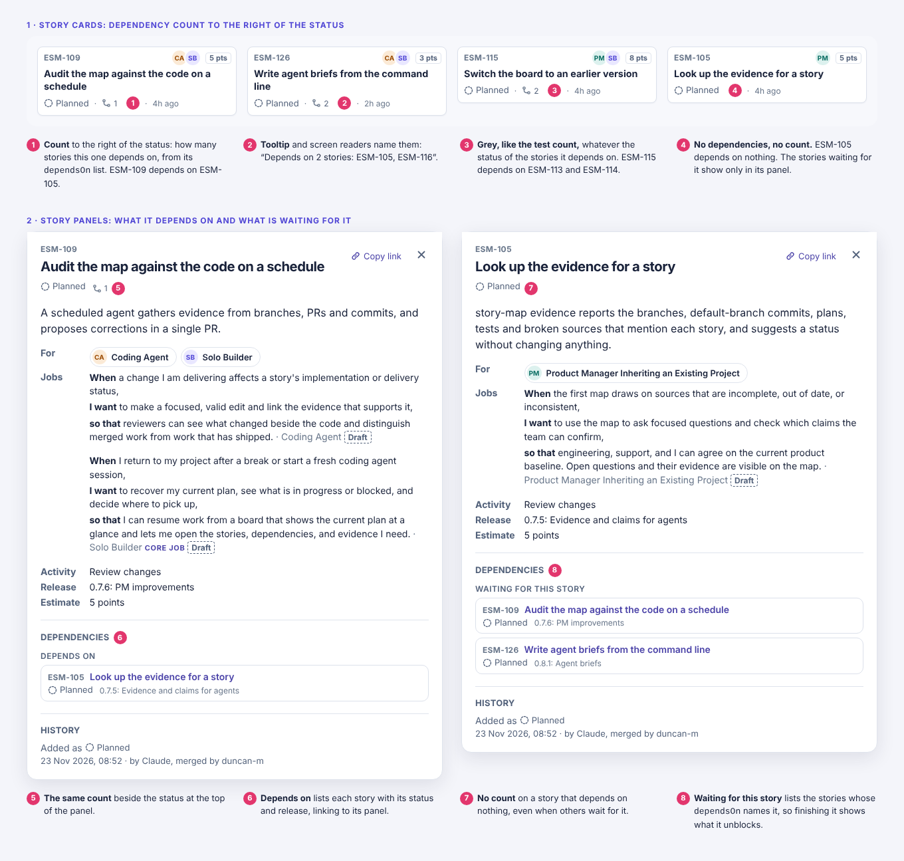

# Plan: show story dependencies

Status: built. The work is ESM-129 in the **0.7.5: Evidence and claims for agents** release of the map.

Stories already say what they need in their notes and plans, such as “Needs ESM-113 and ESM-114”, but the board never shows it. A builder has to read every story to find a workable build order, and nothing on the story that is needed says what is waiting for it.

Dependencies are internal only. The customer view does not change.

## UI mockup



The mockup, made before the build, is [story-dependencies-mockup.html](story-dependencies-mockup.html), built on the real `styles.css` and the board's real markup, rendered from this product's map, status history and tests index. The dependencies are real ones from the stories' notes and plans. The panels leave out their Changes, Tests and Engineering sections. The dependency markup and its styles at the top of the file are proposed. To refresh the image, open it in a browser at 1360 px wide and take a full-page screenshot. ESM-129 links to this section from its `sources`.

What it shows:

1. **Count** to the right of the status on each card: how many stories this one depends on.
2. **Tooltip** and screen readers name them, such as “Depends on 2 stories: ESM-105, ESM-116”.
3. **Grey, like the test count,** whatever the status of the stories it depends on. The card shows only the count.
4. **No dependencies, no count.** The stories waiting for a story show only in its panel.
5. **The same count** beside the status at the top of the story panel.
6. **Depends on** lists each story with its status and release, linking to its panel.
7. **No count** on a story that depends on nothing, even when others wait for it.
8. **Waiting for this story** lists the stories whose `dependsOn` names this one, so finishing it shows what it unblocks.

## Record dependencies in the map

Each story gets an optional `dependsOn` list of story IDs in the schema:

```yaml
  - id: ESM-109
    title: Audit the map against the code on a schedule
    dependsOn:
      - ESM-105
```

Validate rejects an ID that is not in the map, a story that depends on itself and a cycle. It warns when a story that is not cut depends on a cut story, because that work will not land. The board works out the stories waiting for each story from these lists, so nothing is recorded twice. Existing “Needs ESM-…” notes move into `dependsOn` in the same PR.

`story-map edit` gets `--add-dependency <ID>` and `--remove-dependency <ID>`, and `story-map add` gets `--dependency <ID>`, repeated for each story, so agents record dependencies without editing the YAML by hand. `story-map diff` shows dependencies added and removed.

## Estimate

8 points: the schema field and its checks, the edit and add options, the diff line, the card count, the panel's Dependencies section, moving the existing notes into `dependsOn`, the docs and tests.

## What was built

The guide describes the feature in [Record dependencies](../story-map.md#record-dependencies). The dependencies already written in this map's notes and plans moved into `dependsOn`: ESM-109 and ESM-126 depend on ESM-105, ESM-126 also on ESM-116, ESM-111 on ESM-122, ESM-112 on ESM-111, ESM-115 on ESM-113 and ESM-114, and ESM-127 on ESM-112.

The handoff brief from ESM-123 does not list dependencies yet. Adding them to its `<target>` section is a follow-up.
