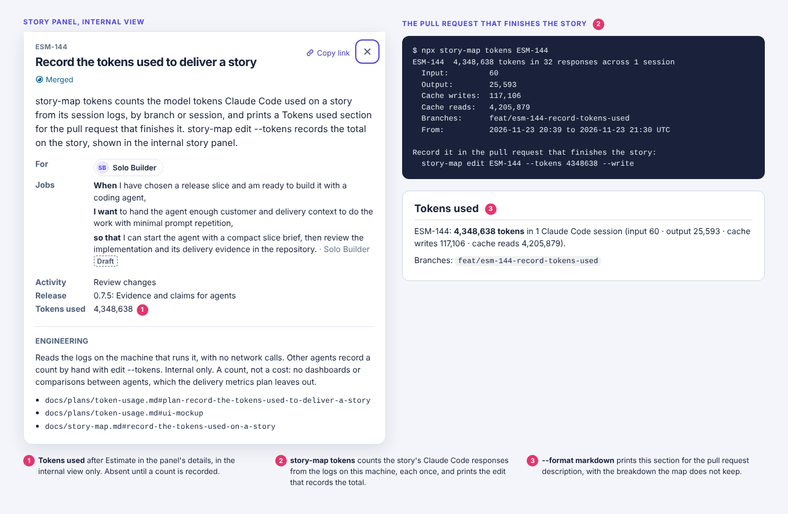

# Plan: record the tokens used to deliver a story

Status: built. The work is ESM-144 in the **0.7.5: Evidence and claims for agents** release of the map.

Agents deliver most stories in this map, but nothing records what that work used. A builder who wants to know whether a story was cheap or expensive to hand to an agent has to dig through each session's `/cost` output, if they kept it. This plan records one number per story, in the pull request that finishes it, from the logs the agent already writes.

It builds on the evidence lookup (ESM-105, merged), which finds a story's branches by their names, and on `story-map edit` (ESM-744, shipped), which records the count. It is not the cost-per-token dashboards that the [delivery metrics plan](delivery-metrics.md#not-now) leaves out: there are no charts, prices or comparisons between agents.

Tokens are internal only. The customer view does not change.

## UI mockup

The mockup is [token-usage-mockup.html](token-usage-mockup.html), built on the real `styles.css`. The story panel is the real board rendered from this product's map, with ESM-144 marked merged and its tokens recorded, as the pull request that finishes it leaves it. The terminal and pull request section are what `story-map tokens` prints for this session. To refresh the image, open it in a browser at 1360 px wide and take a full-page screenshot. ESM-144 links to this section from its `sources`.

What it shows:

1. **Tokens used** in the story panel's details, after Estimate, in the internal view only. A story with no count shows no row.
2. **`story-map tokens <ID>`** counts the story's responses from the Claude Code logs on this machine and prints the edit that records the total.
3. **`--format markdown`** prints the **Tokens used** section for the pull request description, with the breakdown by kind that the map does not keep.

## Count the tokens from the agent's logs

Claude Code writes every session to `~/.claude/projects/<folder>/<session>.jsonl`, or under `$CLAUDE_CONFIG_DIR`. Each model response is a line with its `usage`, the session ID and the Git branch it was made on. Subagents write their own files under the session's folder.

`story-map tokens <ID>` reads those files and counts a response when:

- its branch contains the story ID as a whole word, such as `feat/esm-144-record-tokens-used` for ESM-144 but not a longer number that starts with 144, as the repository's branch rules already ask;
- or its branch is one given with `--branch`, such as the generated branch a cloud session started on before it was renamed;
- or its session is one given with `--session`.

Claude Code writes a line per content block, each with the same usage, so each response is counted once, by its message and request IDs. The total adds input, output, cache-write and cache-read tokens, because all four are tokens the model processed. The breakdown is printed beside it, since cache reads are usually most of the total.

It reads the logs only, with no network calls, and changes nothing. When it finds nothing it exits 1 rather than reporting 0, so a script never records a count of zero for work done elsewhere.

## Record the count on the story

Each story gets an optional `tokens` field, a whole number, in the schema. `story-map edit <ID> --tokens <n>` sets it, and the `tokens` operation does the same in `--from` files. `story-map diff` shows it as “Tokens used: none → 4,348,638”, `story-map story` prints it, and the JSON export carries it. The board shows it in the story panel.

Record it in the pull request that finishes the story, the one that marks it `merged`, from `story-map tokens`. When several pull requests deliver a story, the count covers every branch named for it whose logs are on the machine that runs the command. A person can add counts from other machines or other agents and record the sum by hand.

## Not now

- **Other agents' logs.** Codex, Cursor and others keep their own formats. They can record a count by hand with `edit --tokens` until a team asks for a reader.
- **Cost.** Prices change and differ by model and plan, so the map records tokens, not money.
- **Release totals and charts.** The delivery metrics plan leaves out cost dashboards and agent leaderboards, and this plan keeps to that.
- **Counting on CI.** The logs live on the machine that ran the agent, so CI cannot count them.

## Estimate

None agreed yet. The PR flags it.
