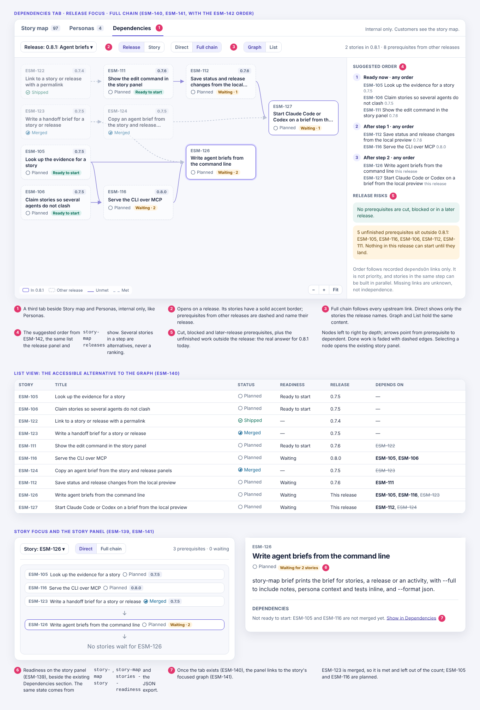

# Plan: Visual dependency map

Status: proposed. Planning and backlog only; no implementation in this PR.

Release proposal: readiness (ESM-139) in **0.7.6: Triage, readiness and agent access**, then **0.8.1: Dependency planning and graph** for order, briefs and the graph, before the proposed delivery analytics releases. It builds on the `dependsOn` links from ESM-129, described in [Record dependencies](../story-map.md#record-dependencies) and planned in [the story dependencies plan](story-dependencies.md), rather than adding a second dependency system. Readiness and a suggested order come first, where agents and the existing panels can use them. The graph follows in the same release.

0.7.6: Triage, readiness and agent access

1. [Work out readiness and dependency risks](#1-work-out-readiness-and-dependency-risks) (ESM-139)

0.8.1: Dependency planning and graph

2. [Suggest a delivery order for a release](#2-suggest-a-delivery-order-for-a-release) (ESM-142)
3. [List prerequisites in agent briefs](#3-list-prerequisites-in-agent-briefs) (ESM-143)
4. [Explore dependencies as a graph](#4-explore-dependencies-as-a-graph) (ESM-140)
5. [Focus on a release or story](#5-focus-on-a-release-or-story) (ESM-141)

Estimates: ESM-139 5 points in 0.7.6, and ESM-142 5 and ESM-143 3 in 0.8.1. ESM-140 and ESM-141, also in 0.8.1, have none yet. No customer-facing copy is approved.

## Why and customer outcome

The Solo Builder needs to see what is ready to build, which prerequisites must land first, and a sensible sequence for parallel agent work, without opening every story or keeping a second planner. The PM inheriting a project needs to inspect the prerequisite chain behind an existing commitment, including dependencies that span releases. A coding agent needs a compact, deterministic prerequisite summary in the brief it is handed and from the CLI, and must not invent relationships.

Success: an internal viewer or an agent can pick a release or story, see the explicit dependency chain and the unfinished prerequisites, and open the existing story panel for evidence and context.

## What exists today

ESM-129 shipped the `dependsOn` field, its validation (unknown IDs, duplicates, self-dependencies and cycles are errors; a dependency on a cut story is a warning), `story-map edit --add-dependency` and `add --dependency`, the diff line, the dependency count on cards, and the story panel's **Depends on** and **Waiting for this story** lists. `story-map story` and the JSON export carry `dependsOn` and `dependents`.

What is missing is any judgement across those links: whether a story can start, what order a release can be built in, and what the whole chain behind a release looks like. ESM-123's handoff brief does not list dependencies yet; the story dependencies plan left that as a follow-up, which ESM-143 picks up.

The YAML file stays the source of truth. Nothing in this plan writes dependencies or statuses.

The map is small today: before this plan, 24 dependency links across 93 stories, and no chain longer than three links. Design for growth, but do not build for a hairball the map does not have.

## UI mockup

The mockup is [visual-dependency-map-mockup.html](visual-dependency-map-mockup.html), built on the real `styles.css` and the board's tab and status markup. Every story, status, release and dependency in it is from this map: release 0.8.1 with everything it depends on. Readiness, the suggested order, the layout and their styles are proposed. To refresh the image, open it in a browser at 1360 px wide and take a full-page screenshot.

What it shows:

1. A **Dependencies** tab beside Story map and Personas, internal only.
2. The tab opens on a release. Its stories have a solid accent border. Prerequisites from other releases are dashed and name their release.
3. **Full chain** follows every upstream link; **Direct** shows only the release's stories and their direct prerequisites. **Graph** and **List** hold the same content.
4. The **suggested order** from ESM-142, the same list the release panel and `story-map releases` show.
5. **Release risks**: cut, blocked and later-release prerequisites, and the unfinished work outside the release. For 0.8.1 today, nothing can start until five stories in other releases land.
6. **Readiness** on the story panel (ESM-139), beside the existing Dependencies section.
7. Once the tab exists, the panel links to the story's focused graph (ESM-141).

## Product decisions

- **Readiness** is worked out from the links each time, never saved as a status.
  - A prerequisite is **done** when it is `merged` or `shipped`: the code is on the default branch, so dependent work can build on it.
  - **Ready to start**: a `planned` story whose prerequisites are all done, or that has none.
  - **Waiting**: a `planned` or `in-progress` story with one or more unfinished prerequisites. An in-progress story that is waiting gets a warning that it started before its prerequisites landed, never an automatic `blocked` status.
  - **At risk**: a story with a prerequisite that is `cut`, `blocked`, or in a later release than the story. At risk takes precedence over waiting.
  - Merged, shipped, blocked and cut stories have no readiness.
  - Missing links are unknown, not proof of independence. Say so wherever readiness is shown.
- **Order** is a deterministic topological sort of unfinished work, in steps. Stories in the same step are alternatives that can run in parallel, not a ranking, and are listed in map order. No critical path, durations or dates from story points.
- **Surfaces, in order:** the story panel, the CLI and the JSON export first, then the release panel, then agent briefs, then the graph. Each later surface reuses the same projection, so the board, the CLI and briefs never disagree.
- **Navigation:** the tab is `view=dependencies`, matching `view=personas`, with `release=<ID>`, `story=<ID>` and `depth=direct|chain`. It defaults to the first release with planned or in-progress stories.
- **Works without JavaScript:** the graph is server-rendered SVG and the list is a table, both readable without `board.js`. Pan, zoom and fit are progressive enhancements, as the board's other controls are.
- **Layout:** start with a simple layered layout: columns by longest path from a root, rows ordered to reduce crossings. It handles the current map and the mockup with no new dependency. Benchmark against a realistic larger map in ESM-140 before reaching for Dagre or ELK, which would add weight to a library hosts embed.
- **Permissions:** never send internal dependency graphs, readiness or order to customer viewers, including JSON or client-side payloads. No browser dependency edits; the existing CLI and PR workflow persists.
- **Error states:** empty maps, no recorded links, filtered-out nodes, cross-release prerequisites, cut and blocked prerequisites, and stale bookmarks must each say what is going on.

## 1. Work out readiness and dependency risks

**Story:** ESM-139 · activity `track` · jobs `triage-backlog`, `plan-and-build`, `pick-up-work`.

Build a pure projection from the validated map that returns, per story, its readiness, its unfinished prerequisites and its risks, plus direct and transitive prerequisites. Show it where people and agents already look. Do not change the YAML schema.

**Acceptance:**
- The story panel shows the readiness beside the Dependencies section, such as “Waiting for 2 stories: ESM-105 and ESM-116 are not merged yet”. A story with no readiness shows nothing.
- `story-map story` prints the same line. `story-map stories --readiness ready|waiting|at-risk`, repeatable, filters by it.
- The JSON export carries each story's `readiness` and its unfinished prerequisite IDs.
- States follow the product decisions above, with the actual blocking IDs and whether each is in the same release.
- Unit tests named `ESM-139:` cover chains, fan-in and fan-out, independent stories, cross-release, blocked, cut, merged and shipped prerequisites, in-progress stories that are waiting, and the customer view leaving it out.

## 2. Suggest a delivery order for a release

**Story:** ESM-142 · depends on ESM-139 · activity `track` · jobs `plan-and-build`, `agree-first-release-plan`, `pick-up-work`.

For a release, show its unfinished stories and their unfinished prerequisites from other releases as ordered steps, with the release's risks. Show it in the release panel and from `story-map releases <ID>`, so it is useful before the graph exists.

**Acceptance:**
- The order respects every recorded dependency, including prerequisites from other releases, which are labelled with their release.
- Stories that can run together share a step, in map order, with no false ranking.
- Risks list cut, blocked and later-release prerequisites, and say when the release cannot start until other releases' work lands. Each story links to its panel.
- The release panel and the CLI say that the order is dependency-only, not priority, claim ownership or approval to build.
- `story-map releases <ID> --format json` and the JSON export carry the steps and risks. No dates or critical-path forecasts.
- Tests named `ESM-142:` cover parallel steps, prerequisites from other releases, risks, determinism and a release with no links.

## 3. List prerequisites in agent briefs

**Story:** ESM-143 · depends on ESM-139 · activity `plan` · jobs `pick-up-work`, `plan-and-build`.

Add each target's prerequisites and readiness to the `<target>` section of the handoff brief, and the release's suggested order to a release brief once ESM-142 lands. This is the follow-up the story dependencies plan left open.

**Acceptance:**
- A story brief lists each prerequisite with its status and release, and says whether the story is ready to start.
- A waiting or at-risk target appears in `<open_decisions>`, with the blocking IDs.
- A release brief lists its targets in suggested order when the order is available, and in map order otherwise.
- Briefs stay compact: IDs, titles and statuses, not the prerequisites' summaries.
- Tests named `ESM-143:` cover ready, waiting and at-risk targets and a release brief.

**Brief fixes found when trying ESM-126.** Running `story-map brief` on this map turned up four more problems. They change the same brief code, so they are part of this story:
- **Personas and jobs once.** `--full` prints each persona and job once, in a section of their own, and each target names them by ID. Today a release brief repeats a persona's full text under every story that serves it, which can double the brief's length.
- **Related context.** `<context>` lists the stories the targets build on, such as their prerequisites and shipped stories in the same activities, instead of the stories in the releases either side. The "Not yet" list names only stories that touch the targets' activities or depend on them.
- **Empty briefs.** A brief with no targets, such as an activity whose stories are all merged or shipped, prints one line saying there is nothing to build and exits with its own code. It suggests no branch, and JSON gives `branch: null` and empty sections. It does not print rules with `<ID>` placeholders or a done-when list.
- **A narrower hint.** When `<context>` leaves stories out, its hint names a command that shows only those, such as `npx story-map stories --activity set-up --status all`, rather than the whole map.
- Tests named `ESM-143:` cover each of these.

## 4. Explore dependencies as a graph

**Story:** ESM-140 · depends on ESM-142 · activity `explore` · jobs `triage-backlog`, `plan-and-build`.

Add the read-only internal Dependencies tab: the graph left to right, arrows from prerequisite to dependent, concise node labels, status and readiness, the suggested order and risks beside it, and a list view with the same content.

**Acceptance:**
- Nodes open the existing story panel and keep existing story and source links.
- The graph and list render on the server and read without JavaScript. Pan, zoom and fit are added by `board.js`. Nodes are keyboard-reachable.
- The view is scoped to a release and says how many nodes come from other releases. There is no all-stories view by default.
- No mutation API or persistence; customer viewers get no dependency data.
- The layout is benchmarked against a generated map several times the size of this one before choosing it.
- UI tests named `ESM-140:` cover interaction, no links, the list view, accessibility and the permission boundary.

## 5. Focus on a release or story

**Story:** ESM-141 · depends on ESM-140 · activity `explore` · jobs `agree-first-release-plan`, `triage-backlog`.

Let the viewer choose a release or focus on a story, with direct neighbours by default and a full-chain option. Keep prerequisites from other releases visible and marked. Link the story panel to its focused graph.

**Acceptance:**
- Release and story selection, the direct and full-chain toggle, and status filters.
- Prerequisites from other releases stay visible and labelled; the view never implies that all prerequisites are inside the release.
- The URL restores the selection using existing permalink conventions, and a stale story or release ID says so.
- Large sets show truncation and expansion without hiding a blocking link.
- Tests named `ESM-141:` cover deep chains, filters, missing and obsolete selections and mixed releases.

## Architecture decisions

Following [Record architecture decisions](../ENGINEERING-OVERVIEW.md#record-architecture-decisions). ESM-139 has shipped, and ESM-140 to ESM-143 are planned.

- **Where it runs.** Inside the existing package: a pure projection of the validated map, shown in the story and release panels, the CLI, the JSON export, the brief and a new internal board tab. The graph is server-rendered SVG with a layered layout written here, and pan and zoom are added by `board.js`. No service, data store or new dependency.
- **Data and contracts.** Upstream, it reads only the `dependsOn` links from ESM-129, and the YAML schema does not change. Downstream: the JSON export carries `readiness` (shipped in ESM-139); `story-map releases <ID> --format json` gains the steps and risks (ESM-142); the brief's `<target>` and `<open_decisions>` gain prerequisites (ESM-143), which agents read; and the board gains `view=dependencies` with `release`, `story` and `depth`.
- **Boundaries.** [Project, then filter, then render](../ENGINEERING-OVERVIEW.md#security-boundaries-to-preserve) and the customer allow-list: customer viewers get no dependency data, including in JSON or client-side payloads. **Permalinks reveal nothing new**: an internal-only or unknown story or release ID gives the same view as no ID, and only internal viewers are told that a bookmark is stale. **React escapes all text**: the SVG's labels are rendered as text, never as markup.
- **Reversibility.** Easy. Everything is worked out from the links each time and nothing is saved, so the tab, the CLI output and the brief lines can each be removed in a release, with a changelog note for the JSON fields.

None: keeps the existing design because it adds computed views over links the map already has, with no new store, service, saved-format field or package export. The new JSON fields and CLI output are additive. If ESM-140's benchmark calls for a layout library such as Dagre or ELK, that adds a dependency every host installs, and becomes a consequential decision for a person to agree before the story continues.

## Delivery sequence

**0.7.6:** ESM-139. The story panel and CLI show readiness, with no new tab.

**0.8.1:** ESM-142 and ESM-143 in parallel, so agents and the existing panels get an order and briefs that name prerequisites. Then ESM-140, then ESM-141. The tab reuses the readiness and order.

Implementation should use focused PRs per story, include the story IDs in test names and commit messages, and run `npm run validate`, the relevant tests and `story-map diff origin/main`.

## Draft release impact

0.7.6:

- **Time to identify the unfinished prerequisites for a chosen story:** shown on its panel and from the CLI, instead of opening each related story in turn; solves opaque build order.

0.8.1:

- **Time to find a feasible sequence for a release:** a ready set and order in the release panel and CLI, without tracing links by hand; solves repeated sequencing work.
- **Release-order dependency conflicts surfaced before implementation:** warnings for prerequisites that are cut, blocked or in later releases; solves hidden planning conflicts.
- **Time to see why a release cannot start:** one view of the release and its prerequisites from other releases, instead of following links story by story; solves long prerequisite chains that span several releases.

All four are hypotheses awaiting human review (`draft: true` in the map). No baseline or actual improvement is claimed.

## Decisions

Agreed in review:

- Order and briefs were first placed in 0.8.4, after the analytics releases, with the graph and focus views in 0.8.5. Readiness (ESM-139) later moved to 0.7.6, so the board says what can start before the analytics releases. Then 0.8.4 became 0.7.9 and took the graph and focus views from 0.8.5, so all of the dependency work comes before the analytics releases.
- A `merged` prerequisite counts as done, and a `blocked` prerequisite makes a story at risk.
- ESM-143 stays a separate story.
